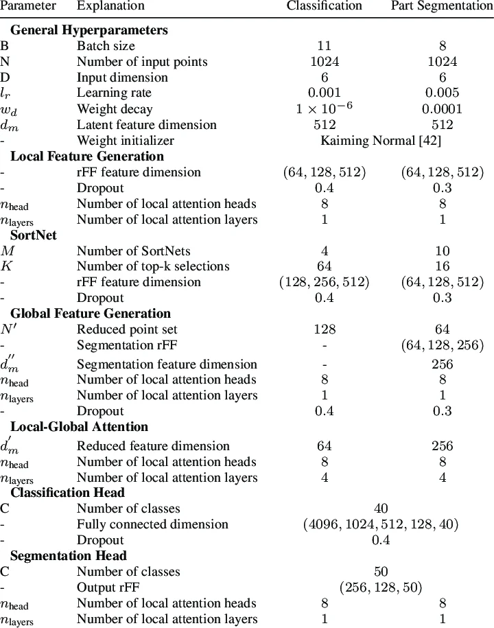

# U-Net アーキテクチャ

## U-Net の入力構造とハイパーパラメータ

### アーキテクチャのハイパーパラメータ

以下の最小値・最大値は、フレームワークによる絶対的な制限ではなく、
ハイパーパラメータ探索で使用しやすい実用的な範囲です。文字列や関数で
指定するカテゴリ型のパラメータには、意味のある数値範囲がないため
`N/A` と記載しています。

| Hyperparameter | Data type | 値または関数の例 | 実用的な最小値 | 実用的な最大値 | 説明 |
|---|---|---|---:|---:|---|
| Input channels | Integer | `1`（グレースケール）、`3`（RGB） | 1 | 16 | 入力画像のチャンネル数です。 |
| Number of output classes | Integer | `1`（二値）、`4`（4クラス） | 1 | 100 | 最終出力のチャンネル数と出力活性化関数を決めます。 |
| Encoder/decoder depth | Integer | `4` stages | 1 | 7 | ダウンサンプリングとアップサンプリングの段数です。 |
| Base filters | Integer | `64` filters | 4 | 512 | 最初のブロックのチャンネル数です。通常は各段で倍にします。 |
| Filter growth factor | Float | `2.0`（`64 → 128 → 256`） | 1.0 | 4.0 | ダウンサンプリング後にフィルター数へ掛ける倍率です。 |
| Convolution blocks per stage | Integer | `2` convolutions | 1 | 4 | 各エンコーダー/デコーダー段の畳み込み層数です。 |
| Kernel size | Integer | `3 × 3` | 1 | 7 | 畳み込みカーネルの空間サイズです。通常は `3 × 3` を使います。 |
| Convolution stride | Integer | `1` | 1 | 2 | 畳み込みの移動幅です。通常、縮小処理は別途行います。 |
| Padding | String / function | `"same"`、`ZeroPadding2D(1)` | N/A | N/A | 畳み込み境界での出力サイズを制御します。 |
| Normalization | String / function | `"batch_norm"`、`GroupNorm(8, C)` | N/A | N/A | 畳み込み後、活性化前に行う任意の正規化です。 |
| Hidden activation | String / function | `ReLU()`、`LeakyReLU(0.1)`、`ELU()` | N/A | N/A | エンコーダーとデコーダーのブロックで使う非線形関数です。 |
| Output activation | String / function | `Sigmoid()`、`Softmax(dim=1)` | N/A | N/A | 二値出力には sigmoid、相互排他的な多クラス出力には softmax を使います。 |
| Pooling method | String / function | `MaxPool2d(kernel_size=2, stride=2)` | N/A | N/A | エンコーダー段の間で行うダウンサンプリング方式です。 |
| Pooling kernel/stride | Integer | `2` | 1 | 4 | プーリングによる空間方向の縮小率です。 |
| Upsampling method | String / function | `ConvTranspose2d(..., stride=2)`、`bilinear` | N/A | N/A | デコーダーで空間サイズを拡大する方式です。 |
| Upsampling scale factor | Integer | `2` | 1 | 4 | 各デコーダー段での空間拡大率です。 |
| Skip connection type | String / function | `"concatenate"`、`Add()` | N/A | N/A | 標準 U-Net ではエンコーダー特徴量とデコーダー特徴量を連結します。 |
| Dropout rate | Float | `0.10`、`Dropout2d(0.1)` | 0.0 | 0.5 | 活性値を無効化する確率です。特徴マップには空間ドロップアウトも使えます。 |
| Attention block | String / function | `"none"`、`AttentionGate()` | N/A | N/A | スキップ接続へ任意で適用するアテンション機構です。 |

### 学習のハイパーパラメータ

| Hyperparameter | Data type | 値または関数の例 | 実用的な最小値 | 実用的な最大値 | 説明 |
|---|---|---|---:|---:|---|
| Initial learning rate | Float | `1e-4`、`3e-4` | 1e-6 | 1e-2 | オプティマイザーの初期ステップ幅です。対数スケールで探索します。 |
| Optimizer | String / function | `AdamW(lr=1e-4, weight_decay=1e-5)` | N/A | N/A | モデルの重みを更新するアルゴリズムです。 |
| Weight decay | Float | `1e-5` | 0.0 | 1e-2 | AdamW や SGD などで使用する L2 型の正則化です。 |
| Momentum / beta values | Float / tuple | `momentum=0.9`、`betas=(0.9, 0.999)` | 0.0 | 0.9999 | オプティマイザー固有の移動平均パラメータです。 |
| Loss function | String / function | `BCEWithLogitsLoss() + DiceLoss()` | N/A | N/A | 学習で最小化する目的関数です。クラス不均衡には Dice や IoU の項が有効です。 |
| Loss weights | Float / tuple | `0.5 * BCE + 0.5 * Dice` | 0.0 | 1.0 | 複数の損失関数を組み合わせるときの相対的な重みです。 |
| Learning-rate scheduler | String / function | `CosineAnnealingLR(T_max=100)`、`ReduceLROnPlateau()` | N/A | N/A | 学習中の学習率の変化を制御します。 |
| Scheduler reduction factor | Float | `factor=0.5` | 0.01 | 0.9 | 停滞時に学習率へ掛ける係数です。 |
| Scheduler patience | Integer | `patience=10` epochs | 0 | 100 | 改善がない状態を何エポック待つかを指定します。 |
| Batch size | Integer | `16`、`32` | 1 | 256 | 1回のオプティマイザー更新で処理する画像またはパッチ数です。 |
| Gradient accumulation steps | Integer | `1`、`4` | 1 | 64 | GPU メモリが少ない場合に実効バッチサイズを大きく見せます。 |
| Number of epochs | Integer | `100` | 1 | 1000 | データセット全体を繰り返し学習する最大回数です。 |
| Early-stopping patience | Integer | `patience=20` epochs | 0 | 200 | 検証性能が改善しない場合に学習を停止するまでのエポック数です。 |
| Minimum improvement (`min_delta`) | Float | `1e-4` | 0.0 | 0.1 | 有意な改善とみなす最小の検証値の変化量です。 |
| Input height/width | Integer | `256 × 256` | 16 | 2048 | 入力画像または学習タイルの空間解像度です。`2^depth` の倍数を推奨します。 |
| Data augmentation probability | Float | `p=0.5` | 0.0 | 1.0 | 各サンプルへ拡張を適用する確率です。 |
| Rotation range | Float | `RandomRotation(15)` | 0.0° | 180.0° | データ拡張で使用する最大回転角度です。 |
| Scale range | Float | `scale=(0.8, 1.2)` | 0.1 | 3.0 | 拡張時に画像を拡大・縮小する倍率です。 |
| Horizontal/vertical flip | String / function | `RandomHorizontalFlip(p=0.5)` | N/A | N/A | 方向に意味がない場合に使用する幾何学的データ拡張です。 |
| Gaussian noise standard deviation | Float | `std=0.01` | 0.0 | 0.5 | 正規化済み入力へ加えるノイズの大きさです。 |
| Validation split | Float | `0.2` | 0.05 | 0.5 | 検証用に確保するデータの割合です。 |
| Mixed precision | Boolean | `True` / `False` | N/A | N/A | 対応環境で FP16 または BF16 を使い、メモリ使用量を減らします。 |
| Random seed | Integer | `42` | 0 | 2,147,483,647 | データ分割や重み初期化の再現性を高めます。 |

