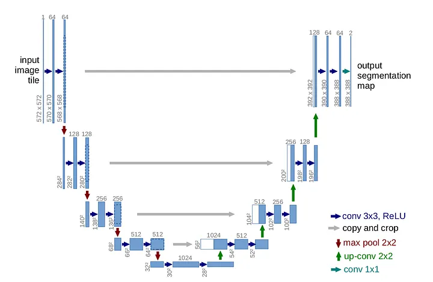

# The U-Net Architecture

## U-Net Input Structure and Hyperparameters

https://www.comet.com/site/blog/deep-learning-for-image-segmentation-u-net-architecture/

### Architectural hyperparameters

The **min/max** values below are practical search bounds rather than hard framework
limits. Categorical parameters use `N/A` because they do not have meaningful
numeric bounds.

| Hyperparameter | Type | Example value or function | Practical min | Practical max | Description |
|---|---|---|---:|---:|---|
| Input channels | Integer | `1` for grayscale, `3` for RGB | 1 | 16 | Number of channels in each input image. |
| Number of output classes | Integer | `1` for binary, `4` for four classes | 1 | 100 | Determines the final output channels and output activation. |
| Encoder/decoder depth | Integer | `4` stages | 1 | 7 | Number of downsampling and upsampling stages. |
| Base filters | Integer | `64` filters | 4 | 512 | Channels in the first block; commonly doubled at each encoder stage. |
| Filter growth factor | Float | `2.0` (`64 → 128 → 256`) | 1.0 | 4.0 | Multiplier applied to the filters after each downsampling stage. |
| Convolution blocks per stage | Integer | `2` convolutions | 1 | 4 | Number of convolution layers in each encoder/decoder stage. |
| Kernel size | Integer | `3 × 3` | 1 | 7 | Spatial size of each convolution kernel; `3 × 3` is the usual choice. |
| Convolution stride | Integer | `1` | 1 | 2 | Step size of a convolution. Downsampling is usually handled separately. |
| Padding | String / function | `"same"` or `ZeroPadding2D(1)` | N/A | N/A | Controls output size at convolution boundaries. |
| Normalization | String / function | `"batch_norm"` or `GroupNorm(8, C)` | N/A | N/A | Optional normalization after convolution and before activation. |
| Hidden activation | String / function | `ReLU()`, `LeakyReLU(0.1)`, or `ELU()` | N/A | N/A | Non-linearity used in encoder and decoder blocks. |
| Output activation | String / function | `Sigmoid()` or `Softmax(dim=1)` | N/A | N/A | Use sigmoid for one-vs-background output and softmax for mutually exclusive classes. |
| Pooling method | String / function | `MaxPool2d(kernel_size=2, stride=2)` | N/A | N/A | Downsampling operation between encoder stages. |
| Pooling kernel/stride | Integer | `2` | 1 | 4 | Spatial reduction factor for pooling. |
| Upsampling method | String / function | `ConvTranspose2d(..., stride=2)` or `bilinear` | N/A | N/A | Decoder upsampling operation. |
| Upsampling scale factor | Integer | `2` | 1 | 4 | Spatial enlargement factor in each decoder stage. |
| Skip connection type | String / function | `"concatenate"` or `Add()` | N/A | N/A | Standard U-Net concatenates encoder features with decoder features. |
| Dropout rate | Float | `0.10` or `Dropout2d(0.1)` | 0.0 | 0.5 | Probability of dropping activations; spatial dropout can be useful for feature maps. |
| Attention block | String / function | `"none"` or `AttentionGate()` | N/A | N/A | Optional attention applied to skip connections. |

### Training hyperparameters

| Hyperparameter | Type | Example value or function | Practical min | Practical max | Description |
|---|---|---|---:|---:|---|
| Initial learning rate | Float | `1e-4` or `3e-4` | 1e-6 | 1e-2 | Initial optimizer step size. Search on a logarithmic scale. |
| Optimizer | String / function | `AdamW(lr=1e-4, weight_decay=1e-5)` | N/A | N/A | Algorithm used to update model weights. |
| Weight decay | Float | `1e-5` | 0.0 | 1e-2 | L2-style regularization, commonly used with AdamW or SGD. |
| Momentum / beta values | Float / tuple | `momentum=0.9` or `betas=(0.9, 0.999)` | 0.0 | 0.9999 | Optimizer-specific running-average parameters. |
| Loss function | String / function | `BCEWithLogitsLoss() + DiceLoss()` | N/A | N/A | Objective optimized during training; Dice or IoU terms help with class imbalance. |
| Loss weights | Float / tuple | `0.5 * BCE + 0.5 * Dice` | 0.0 | 1.0 | Relative weights when combining multiple loss functions. |
| Learning-rate scheduler | String / function | `CosineAnnealingLR(T_max=100)` or `ReduceLROnPlateau()` | N/A | N/A | Controls how the learning rate changes during training. |
| Scheduler reduction factor | Float | `factor=0.5` | 0.01 | 0.9 | Multiplicative reduction used by plateau-based schedulers. |
| Scheduler patience | Integer | `patience=10` epochs | 0 | 100 | Epochs without improvement before reducing the learning rate. |
| Batch size | Integer | `16` or `32` | 1 | 256 | Number of images or patches processed in one optimizer step. |
| Gradient accumulation steps | Integer | `1` or `4` | 1 | 64 | Simulates a larger batch when GPU memory is limited. |
| Number of epochs | Integer | `100` | 1 | 1000 | Maximum complete passes through the training set. |
| Early-stopping patience | Integer | `patience=20` epochs | 0 | 200 | Epochs without validation improvement before stopping. |
| Minimum improvement (`min_delta`) | Float | `1e-4` | 0.0 | 0.1 | Smallest validation improvement considered meaningful. |
| Input height/width | Integer | `256 × 256` | 16 | 2048 | Spatial resolution of input images or training tiles. Prefer dimensions divisible by `2^depth`. |
| Data augmentation probability | Float | `p=0.5` | 0.0 | 1.0 | Probability of applying an augmentation to each sample. |
| Rotation range | Float | `RandomRotation(15)` | 0.0° | 180.0° | Maximum random rotation in degrees. |
| Scale range | Float | `scale=(0.8, 1.2)` | 0.1 | 3.0 | Random resize factor used during augmentation. |
| Horizontal/vertical flip | String / function | `RandomHorizontalFlip(p=0.5)` | N/A | N/A | Optional geometric augmentation; use only when orientation is not semantically important. |
| Gaussian noise standard deviation | Float | `std=0.01` | 0.0 | 0.5 | Noise magnitude added to normalized inputs. |
| Validation split | Float | `0.2` | 0.05 | 0.5 | Fraction of data held out for validation. |
| Mixed precision | Boolean | `True` / `False` | N/A | N/A | Uses FP16 or BF16 where supported to reduce memory and speed up training. |
| Random seed | Integer | `42` | 0 | 2,147,483,647 | Makes data splitting and initialization more reproducible. |
