# Yolo Object Detection Explained

You Only Look Once(Yolo) is a real-time object detection algorithm, introduced in 2015 by Joseph Redmon and Santosh Divvala, Ross Girshick, and Ali Farhadi. 

It is a part of CNN (Convolutional Neural Networks) family and is known for its speed and accuracy in detecting objects in images and videos. 

## What makes Yolo Popular? 

Some of the key features that make Yolo popular are:

1. **Speed**
2. **Detection Accuracy**
3. **Good generalization**
4. **Open Source**

1. YOLO is extremely fast because it does not deal with complex pipelines. It can process images at **45 Frames Per Second (FPS)**. In addition, YOLO reaches more than twice the mean Average Precision (mAP) compared to other real-time systems, which makes it a great candidate for real-time processing. 

From the graphic below, we observe that YOLO is far beyond the other object detectors with 91 FPS.

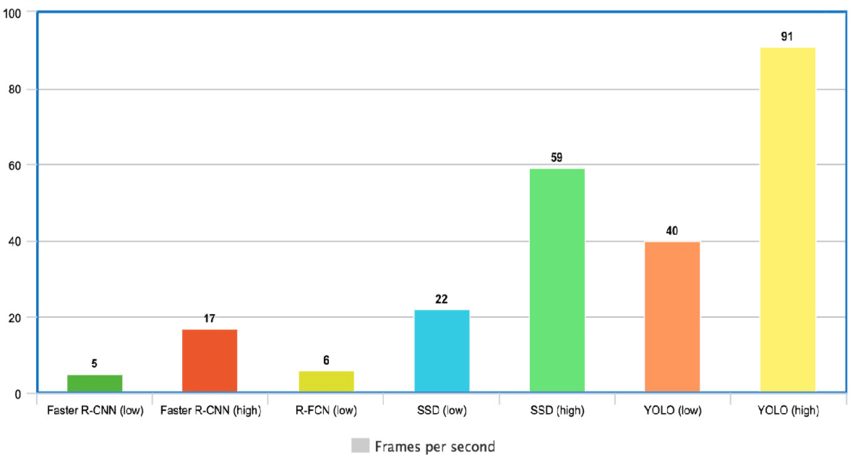

## Yolo Architecture

YOLO architecture is similar to GoogleNet. As illustrated below, it has 24 convolutional layers, four max-pooling layers, and two fully connected layers.

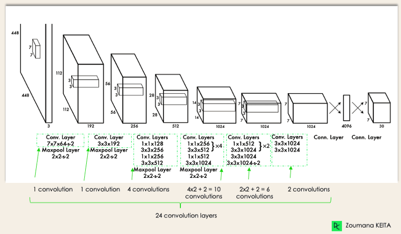

Architecture works as follows:
1. Resizes the input image into **448x448** before going through the convolutional network.
2. A 1x1 convolution is first applied to reduce the number of channels, followed by a 3x3 convolution to generate a cuboidal output.
3. The activation function under the hood is ReLU, except for the final layer, which uses a linear activation function.
4. Some additional techniques, such as batch normalization and dropout, regularize the model and prevent it from overfitting.

## Yolo V4
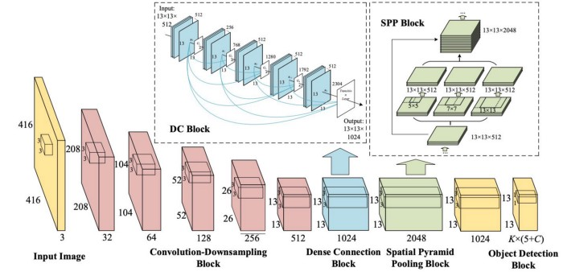

## How does Yolo Object Detection Work?

*"Imagine you built a YOLO application that detects players and soccer balls from a given image.* 
*But how can you explain this process to someone, especially non-initiated people?*

*→ That is the whole point of this section. You will understand the whole process of how YOLO performs object detection and how to get image (B) from image (A)."*

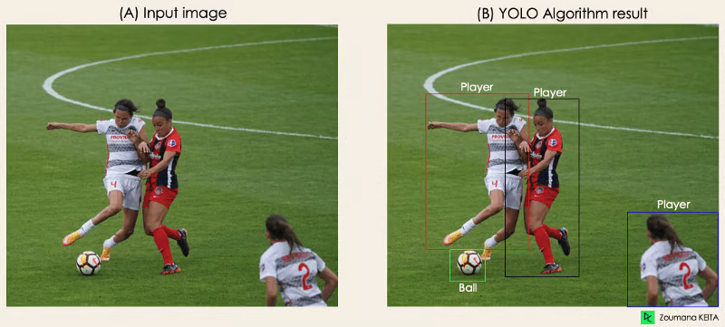

### Algorithm works based on the following steps:

1. Residual blocks
2. Bounding Box regression
3. Intersection over Union (IoU)
4. Non-Maximum Suppression (NMS)

### **Residual blocks**
This first step starts by dividing the original image (A) into NxN grid cells of equal shape, where N, in our case, is 4, as shown in the image on the right. Each cell in the grid is responsible for localizing and predicting the class of the object that it covers, along with the probability/confidence value. 

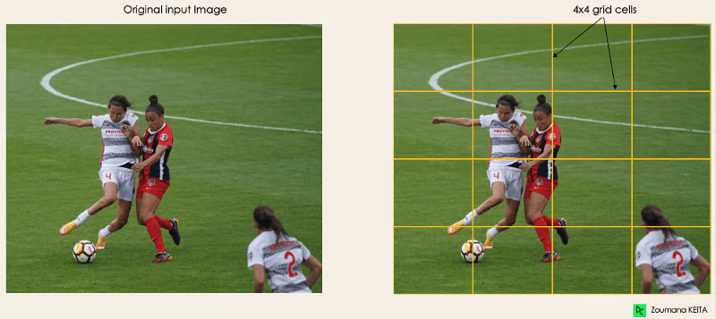

### **Bounding box regression**
The next step is to determine the bounding boxes corresponding to rectangles, highlighting all the objects in the image. We can have as many bounding boxes as there are objects within a given image. 

YOLO determines the attributes of these bounding boxes using a single regression module in the following format, where Y is the final vector representation for each bounding box. 

`Y = [pc, bx, by, bh, bw, c1, c2]`

This is especially important during the training phase of the model.

- `pc` corresponds to the probability score of the grid containing an object. For instance, all the grids in red will have a probability score higher than zero. The image on the right is the simplified version since the probability of each yellow cell is zero (insignificant). 

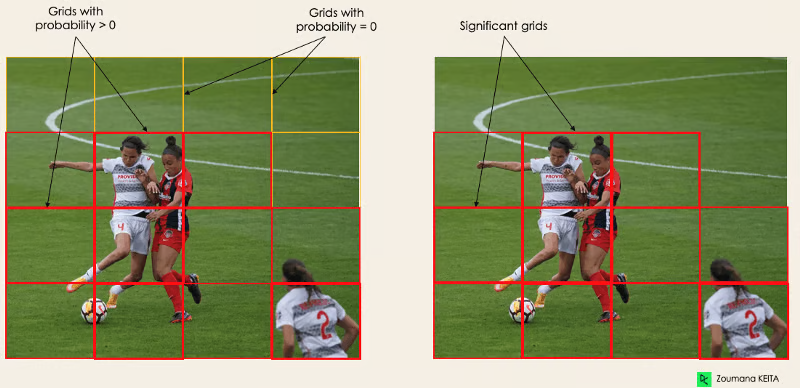

- `bx`, `by` are the x and y coordinates of the center of the bounding box with respect to the enveloping grid cell. 
- `bh`, `bw` correspond to the height and the width of the bounding box with respect to the enveloping grid cell. 
- `c1` and `c2` correspond to the two classes, Player and Ball. We can have as many classes as your use case requires. 

To understand, let’s pay closer attention to the player on the bottom right.

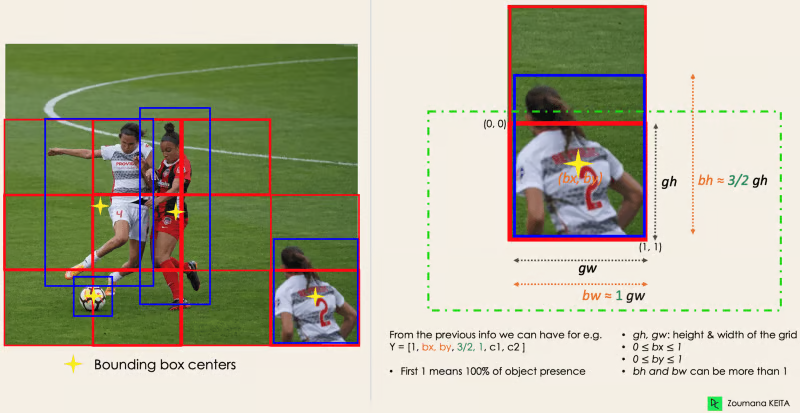

### **Intersection over Union (IoU)**

Most of the time, a single object in an image can have multiple grid box candidates for prediction, even though not all are relevant. The goal of the IOU (a value between 0 and 1) is to discard such grid boxes to only keep those that are relevant. Here is the logic behind it: 

- The user defines its IOU selection threshold, which can be, for instance, 0.5. 
- Then, YOLO computes the IOU of each grid cell, which is the Intersection area divided by the Union Area. 
- Finally, it ignores the prediction of the grid cells having an IOU ≤ threshold and considers those with an IOU > threshold. 

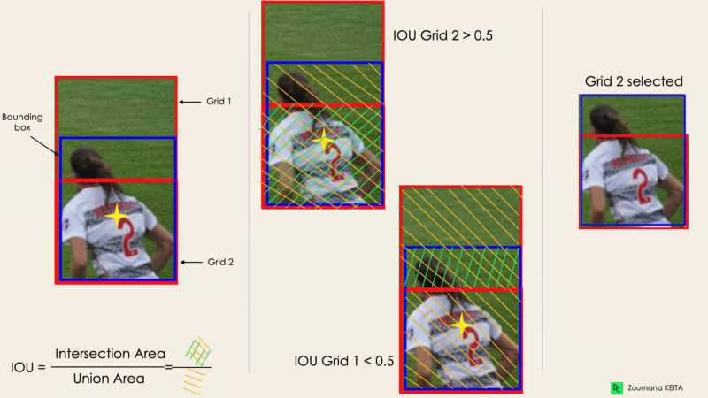

## Yolo application

1. Healthcare:

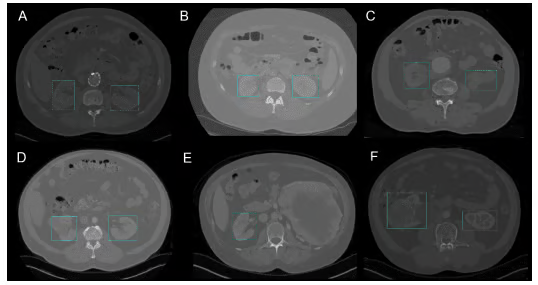

2. Agriculture:

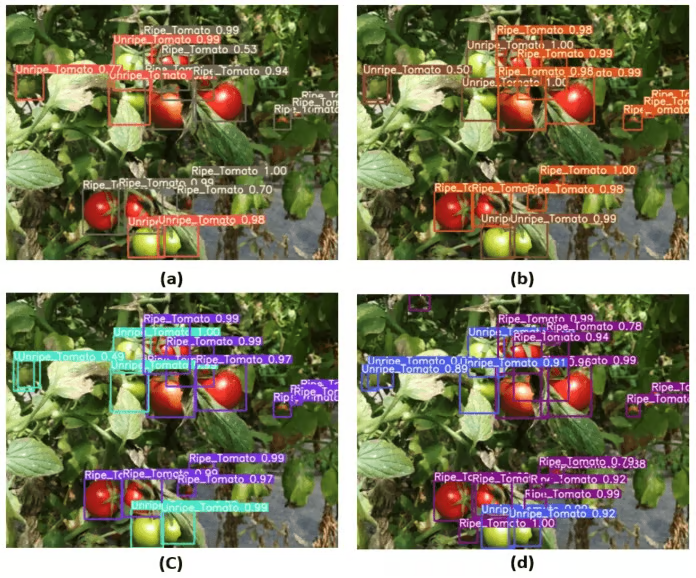

## Versions of Yolo

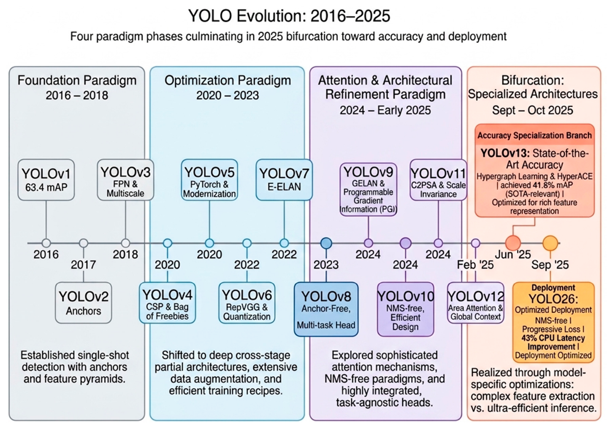

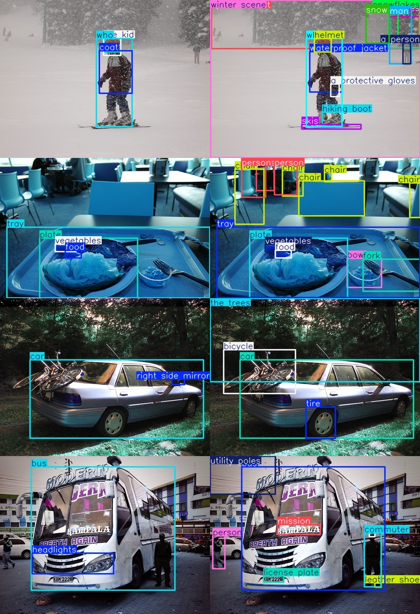

Yolo is capable of detecting large objects, but what about small objects? The answer is Yolo-Sam, which is a combination of Yolo and Sam.

## Yolo + SAM(Segment Anything Model)

## SAM(Segment Anything Model)

SAM is a segmentation model that can be used in conjunction with Yolo to improve the accuracy of object detection and segmentation. IT can take prompts in the form of points, boxes, or text to generate a mask for the object of interest.

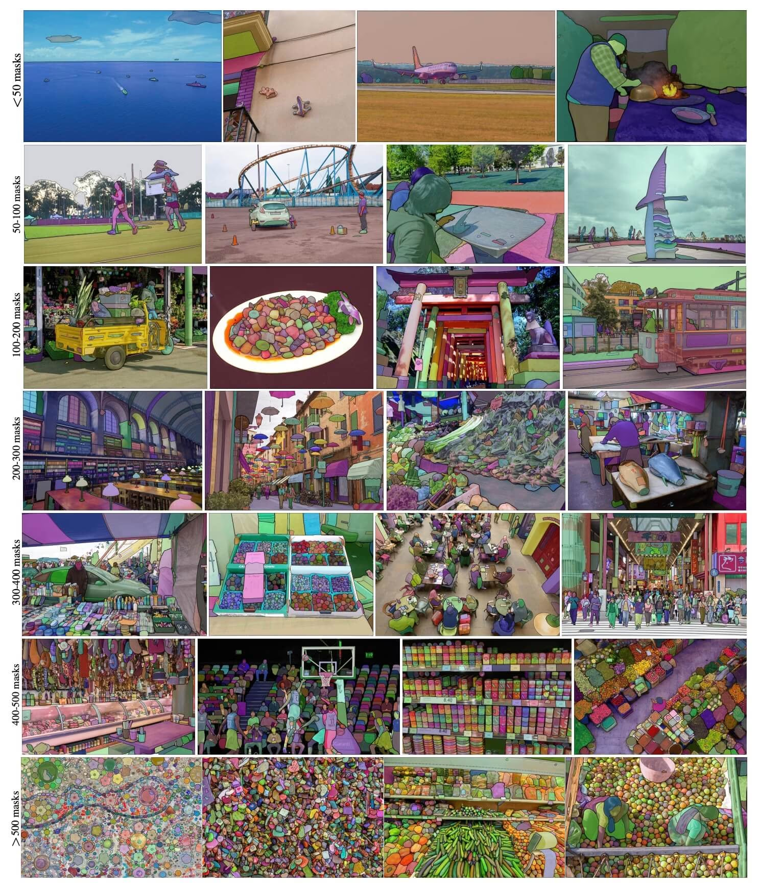

But we cannot train SAM from scratch. only the pre-trained model is available. The pre-trained model can be used to segment objects in images and videos, and it can be fine-tuned for specific tasks. We can do Inference using the pre-trained model, but we cannot train it from scratch.

- But will competition rules allow us to use pre-trained models? The answer is NO. We cannot use pre-trained models in competitions. We have to train the model from scratch.

## Yolo-Sam Model

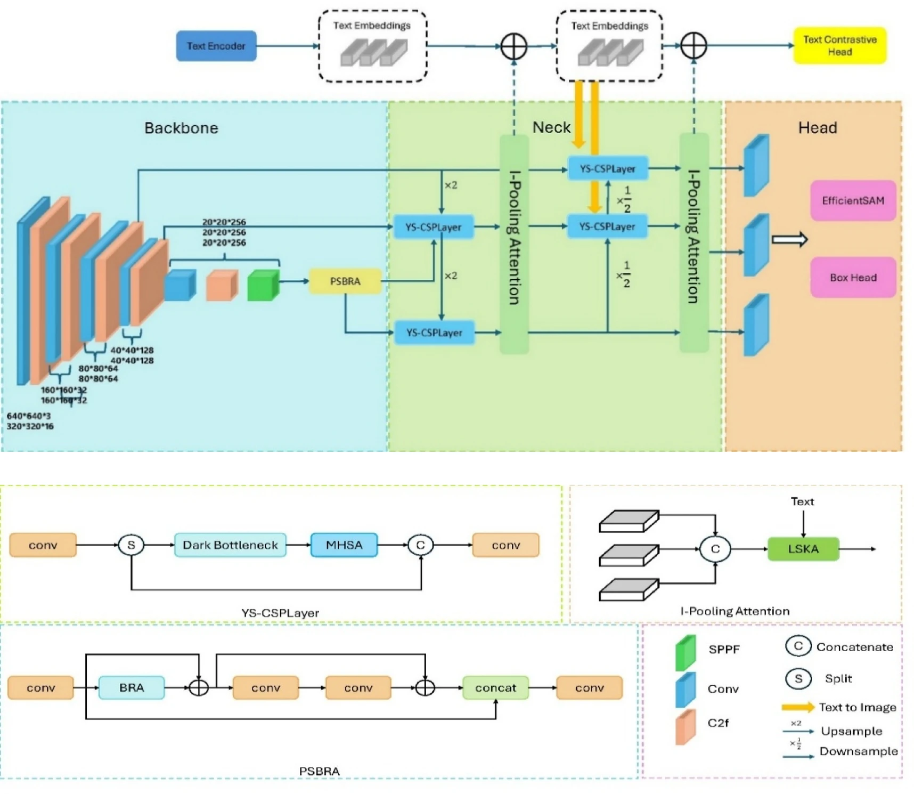

