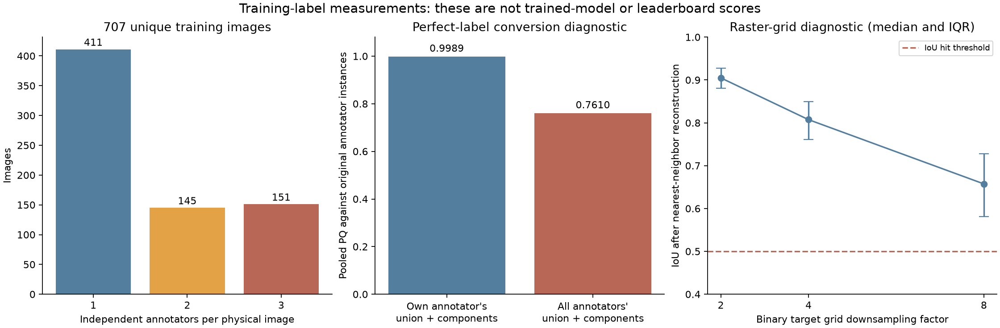
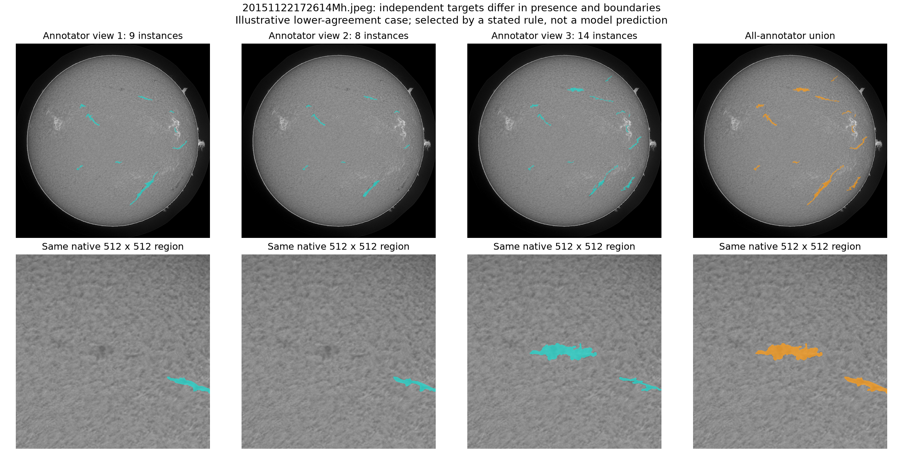

# Solar Filament Segmentation Challenge 2026: research and next experiments

Research date: **3 November 2026**, Asia/Tokyo. This report combines the competition's published material, primary research papers, authors' public experiment reports, the four supplied notebooks, and a new audit of every supplied training annotation. The production notebook was not changed during this research.

**The next experiment should change the target and instance-formation policy before changing YOLO again.** Your original 0.36 notebook already has a useful feature that the preprocessing branch lost: it trains each annotator's drawing as a separate sample. The preprocessing branch merges all drawings for an image into a hard union. A native-resolution U-Net mask model, using YOLO for instance proposals/grouping, is the strongest larger follow-up supported by the public evidence. Neither a 0.39 model ceiling nor a guaranteed gain from this recommendation has been established.

The user's reported results are 0.36 for the original YOLO26 notebook, 0.32 for the preprocessing branch, and 0.33 after the YOLO11 switch. **Archive update:** the subsequently provided `Best/results.zip` has now been analyzed. Its held-out report PQ is **0.4234**, calibration PQ is **0.4204**, and the actual training history contains **41 completed epochs**. The [latest-run analysis](latest_run/RUN_ANALYSIS.md) supersedes the initial uncertainties below about checkpoint selection, selected mode and the run's error profile. It identifies small-instance recall and a failed-disk-fit/raw-input cohort as measured weaknesses; the cause of the local/public gap is still unresolved.

**What the competition rewards.** The task is an individual mask for each filament, including its fine morphology, from the provided H-alpha test images. The published evaluation changed to Panoptic Quality on 7 August; the leaderboard was rescored on 12 August. Final judging combines quantitative assessment (70%) and qualitative assessment (30%), including morphology and reproducibility. The overview restricts other ground-truth metadata, and requests a four-page report, public reproducible repository, requirements and notebook for final evaluation. Its published final report/solution date is 15 November 2026; the exact deadline timezone should be checked on Kaggle's timeline because the overview's printed timezone is ambiguous. These details come from the [organizers' overview and announcements](https://www.kaggle.com/competitions/filament-segmentation-2026/overview/announcements).

Some overview text still refers to mean Dice in an older submission paragraph. The dated PQ update and the organizers' actual self-evaluation implementation are the relevant sources for local scoring. Historical July Dice scores must not be compared numerically with current PQ. Organizers also emphasize that final evaluation goes beyond public ranking in [their discussion replies](https://www.kaggle.com/competitions/filament-segmentation-2026/discussion/742143).

**What was verified about the metric.** I inspected the supplied local copy of the [organizers' self-evaluation notebook](https://www.kaggle.com/code/azimahmadzadeh/self-evaluation-notebook), specifically `process_entry`, `get_overlap_df` and `get_pq_score`. It scores a prediction against each annotator-image record separately, accepts IoU strictly greater than 0.5, and pools matched-IoU sums, TP, FP and FN. It does not average image-level PQ or score against an all-annotator union. The audit implementation was checked against that notebook on seven synthetic cases, including empty predictions and overlapping targets.

The formula is `PQ = sum(matched IoUs) / (TP + 0.5*FP + 0.5*FN)`, equivalently `SQ * RQ`. SQ measures overlap among accepted matches; RQ reflects successful instance recognition. A very narrow structure can cross the match threshold after a small boundary shift: two long three-pixel-wide strips shifted sideways by one pixel have IoU 0.5, which fails the strict rule. This is a toy illustration, not a measurement of typical filament width. The original [Panoptic Segmentation paper](https://arxiv.org/abs/1801.00868) explains why pixel delineation and instance recognition need separate attention.

One subtlety matters when borrowing implementations. The supplied organizer code includes every above-threshold overlap, rather than explicitly imposing one-to-one matching. Some public repositories use greedy one-to-one assignment. In our perfect-union diagnostic, changing between these rules changes pooled PQ by only **0.0000465**. That observation applies to this diagnostic; it is not a guarantee for every possible prediction. Our current preprocessing notebook already follows the supplied organizer's all-hit rule, so this discrepancy is not evidence of a large current scoring bug.

**What the training data actually contains.** The following values were measured from the local competition files, without downloading external annotations. The annotation JSON SHA256 is `5da9e92b5a1a1947fd5d57adb6688269625c48ec1ef884daf2a01618c9ed54a1`.

| Measurement | Verified value |
| --- | ---: |
| Unique training images | 707 |
| Annotator-image records | 1,154 |
| Annotated filament instances | 8,199 |
| Test image filenames | 180 |
| Image shape recorded in training JSON | 2048 × 2048 |
| Images with one / two / three annotator views | 411 / 145 / 151 |
| Images with multiple views | 296, or 41.9% |
| Median individual instance area | 1,228 pixels |
| Instances below 1,000 pixels | 41.3% |
| Median foreground fraction, all-annotator union | 0.3665% of the full frame |
| Train/test filename overlap | 0 |
| Train/test dates shared | 31 dates; 33 test images share a training date |

There are six site suffixes and observations from 2011–2022. Site counts are reasonably balanced, while recent low-activity years have few examples. Shared dates show why physical filename grouping is necessary but date grouping is a stronger validation precaution. These counts do not establish that train/test distribution shift is absent; that would require the latest prediction errors and more detailed image-quality analysis.

The JSON's four categories describe chirality/ambiguity, while this submission predicts filaments as one class. The current single-class treatment is appropriate for the requested output. The dataset authors explain that images have independent, double-blind annotations and that brush/eraser masks were stored as detailed polygons. Their published kappa of 0.66 concerns assigned chirality labels; it is not a segmentation-PQ ceiling. See the [MAGFiLO authors' data documentation and Q&A](https://www.mlecofi.net/magfilo).

**The most important local measurement: merging annotators changes the target.** I constructed diagnostic predictions directly from the training ground truth, then evaluated them against the original annotator-specific instances using the supplied scorer's semantics. No network was trained for this comparison.

| Training-label diagnostic | All 1,154 views: pooled PQ | Multiple-annotator sources only: pooled PQ |
| --- | ---: | ---: |
| Each annotator's own mask union → 8-connected components, area ≥20 | 0.9989 | 0.9994 |
| Union across all annotators → 8-connected components, area ≥20 | 0.7610 | 0.6222 |
| Union across all annotators → components, area ≥200 | 0.7591 | 0.6216 |

The first row knows which annotator is being evaluated; it is an identity/conversion diagnostic, not a feasible shared prediction for an unknown annotator. The second row makes one shared union prediction per physical image. Its lower score demonstrates a target/evaluation mismatch: material drawn by one expert can be an unmatched prediction against another, and disagreement can enlarge or join instances. Raising the area cutoff from 20 to 200 does little to resolve that disagreement.

These scores are **not validation results, predicted public scores, or mathematical ceilings**. A learned model need not output the exact hard union it was trained on, and the best shared prediction may differ from that union. The 0.7610 result also leaves substantial headroom above 0.33; target merging alone cannot explain the entire observed model gap.

I also checked an initially plausible alternative explanation and found little support for it in the ground truth. Only **30 of 8,199 annotations** have more than one 8-connected component, and only **two** have more than one component of at least 20 pixels. Thus, fragmentation of the original raster annotations is rare. Fragmentation of a learned probability map remains a separate issue that needs actual model predictions.

Cross-scoring independent annotators gives **0.3399 pooled PQ**, or **0.3436** when averaging the pairwise scores within each physical image and then across the 296 images. Human disagreement helps explain difficult evaluation, but it is not a model upper bound. A consensus predictor trained across many examples can score differently from one particular annotator against another.



The example below was selected near the lower quartile of union agreement among three-view images with at least ten annotations. It illustrates disagreement about both presence and boundaries; it is not a representative model prediction or a cherry-picked improvement. The selection rule and crop coordinates are recorded in `figure_metadata.json`.



**A second measurement: coarse mask targets lose detail, but do not by themselves explain 0.33.** Each original instance mask was downsampled on the original image grid with OpenCV bilinear resizing of the binary target, then reconstructed with nearest-neighbor interpolation. Cropped calculations were verified against full-frame calculations at all three factors.

| Binary target downsampling factor | Median reconstructed IoU | Instances still above IoU 0.5 |
| --- | ---: | ---: |
| 2 | 0.9048 | 100.00% |
| 4 | 0.8074 | 99.96% |
| 8 | 0.6574 | 91.16% |

This measures a raster-grid operation, not the output of a learned prototype decoder, its architectural limit, or its best possible reconstruction. The current `mask_ratio=4` deserves attention for edges, but nearly all isolated ideal masks still clear the matching threshold in this simplified test. Changing `mask_ratio` only changes training-target rasterization; it does not increase the model's prototype resolution. The pinned [Ultralytics polygon rasterizer](https://github.com/ultralytics/ultralytics/blob/v8.4.171/ultralytics/data/utils.py) fills a polygon at full resolution and then resizes its mask. Native-resolution U-Net prediction is attractive because it offers a different mask representation, not because this diagnostic proves a 0.33 YOLO limit.

**The original baseline and current branch are not controlled preprocessing-only comparisons.** These are code defaults and implementation differences, not verified settings for every historical submission.

| Component | Supplied original 0.36 notebook | Current preprocessing branch |
| --- | --- | --- |
| Model default | YOLO26s-seg | YOLO11s-seg |
| Training sample | One annotator-image record | One physical image with all-annotator union |
| Label export | Each annotation is converted independently | Connected components of the merged union |
| Sample identity | `image_id` participates in sample filename | One sample per physical filename |
| Input default | Raw grayscale | Solar normalization/enhancement |
| Split | Grouped by physical filename | Grouped by date, train/calibration/report |
| Epoch default in supplied code | 150 | 5 |
| Checkpoint selection | YOLO's best checkpoint, then confidence calibration | Best/last compared on calibration PQ |

In the original notebook, inspect cell 10, `worker_process_record`: it builds `sample_stem` from `image_id` and loads only that record's annotations. In the preprocessing branch, cell 13, `merged_annotation_mask` merges every record for the filename. This is direct evidence from the supplied files, and is a stronger reason for an ablation than another generic model recommendation. Restoring annotation-aware supervision changes an earlier preserved pipeline choice deliberately; it should be a separately named experiment.

The current inference path has another shared bottleneck across both YOLO families. `NativeProbabilityPredictor` takes a maximum over detection masks for each confidence threshold, averages these semantic maps over D4 views, and forms final connected components. The single-view candidate also unions masks before extracting components. Thus, detector instance identities are discarded by every current mode. A good grouping predicted by YOLO can be lost; conversely, a broken learned mask becomes multiple predictions. Avoiding output overlaps does not require discarding identity: a confidence-ordered ownership rule can make masks disjoint while retaining each proposed instance.

Inspect the latest `selected_pipeline.json` before drawing conclusions about the newer methods. If the selected mode is `union_cc`, the final submission uses the single-view baseline candidate; computing eight-view maps does not mean they contributed to the selected output. The later archive confirms that **hysteresis won**, with eight D4 views. It improved calibration PQ from the best single-view candidate's 0.3558 to 0.4204; see the latest-run analysis. The conditional baseline-selection warning does not describe this run.

Five epochs also represent a small optimization budget in the notebook's default configuration. **The actual archived run instead requested 100 epochs and logged 41**, so the following five-epoch calculation is not its completed training budget. With roughly 561 training images, global batch two and nominal batch 16, steady-state accumulation is about eight minibatches per optimizer update: approximately 175 updates in five epochs, before warmup effects. Actual update counts need logging. The [pinned trainer](https://github.com/ultralytics/ultralytics/blob/v8.4.171/ultralytics/engine/trainer.py) makes this accumulation explicit. The reported unchanged score at 50 epochs is still important evidence, but checking loss curves, checkpoint hashes, actual optimizer steps and two-decimal leaderboard rounding is necessary before inferring convergence or a capacity ceiling.

**What public results support, and what they do not.** All public scores below are author reports. I read source or the supplied notebook, but did not reproduce those trained models or independently verify their Kaggle submission histories.

| Primary source | Reported result | Relevant method | Limitation |
| --- | --- | --- | --- |
| Supplied U-Net notebook, Dariush Afshar | 0.4502 nested OOF; 0.39 public | Five ResNet34 and five EfficientNetV2-S U-Nets; native full-frame probabilities, D4, peak/mean/area filtering | Inference notebook; training folds and weights were not reproduced here. Its split is not established as equivalent to our date-grouped holdout. |
| [Amey Pawar's reproducible entry](https://github.com/ameyypawar/filament-seg) | U-Net alone 0.371 validation; detectors alone 0.383; hybrid 0.4214 cross-fitted validation and 0.37 public | Native 512-pixel U-Net crops, separate annotator views, detector-guided pixel ownership | Different models and split; source is available, but this report did not rerun the weights. |
| [HeShen-1's experiment repository](https://github.com/HeShen-1/filament-segmentation-2026) | 0.3593 five-fold mean; best public 0.35 | YOLO11m plus seed-conditioned U-Net refiner and annotator-medoid targets | Fusion did not consistently beat its strongest member; more training had fold-dependent gains. |
| [Artem Shelamanov's October report](https://www.shelamanov.com/portfolio/solar) | 0.40 public PQ | YOLO proposals, native-resolution U-Net masks, five-detector voting and quality scoring | Public implementation not yet available on that page; this is an unverified author report. |

Pawar's [fusion source](https://github.com/ameyypawar/filament-seg/blob/main/filament_seg/fusion.py) preserves an instance label while assigning U-Net pixels inside a grown detector mask. This is materially different from converting all YOLO outputs into a single semantic maximum followed by connected components. Its [training sampler](https://github.com/ameyypawar/filament-seg/blob/main/filament_seg/dataset.py) uses native crops and foreground-biased sampling. These are transferable design ideas; its thresholds and exact ensemble are not established as optimal for our models.

Shelamanov reports a gain from 0.35 to 0.37 after training the mask model on every annotator, followed by improvements from instance scoring and fragment merging. This supports testing annotation-aware masks and instance handling. It does not establish that copying an ensemble will improve our score.

The HeShen repository is useful negative evidence: its reported 50-to-100-epoch gain on one fold did not transfer across five folds, and increasingly permissive same-family fusion imported false positives. Its claims about an SQ "ceiling" should be read as that author's interpretation, not a mathematical limit.

The supplied U-Net notebook's sparser-test-label explanation is explicitly a hypothesis fitted to a small submission history. It is not proof of the hidden test-label process, and does not justify arbitrarily dropping predictions to chase a public score.

**Relevant papers favor detailed masks, with important evaluation caveats.** [EdgeAttNet (2025)](https://arxiv.org/html/2509.02964v1) uses a U-Net-style encoder/decoder with learned edge-guided attention and BCE plus Dice. It reports pairwise mIoU 0.6451 and multiscale IoU 0.7032 on its MAGFiLO split. Those values are not competition PQ: its pairwise metric focuses on spatially intersecting predictions, and its data/split differ. Its architecture is an interesting later ablation; weights trained on the full original MAGFiLO should not be treated as competition-train-only weights.

[Diercke et al. (2024)](https://arxiv.org/html/2402.15407v1) combine YOLO localization with U-Net pixel segmentation for solar filaments. This provides domain-specific support for separating proposals from precise masks. Their semi-supervised archive and reported accuracy use a different data and evaluation setup, so the numerical result is not a competition benchmark or permission to import additional labels.

[clDice (CVPR 2021)](https://arxiv.org/abs/2003.07311) offers a differentiable centerline-based loss for tubular structures. A small auxiliary topology term is worth an ablation after a BCE-plus-Dice baseline works. It is not a substitute for instance identity and can encourage unwanted connections if applied indiscriminately to neighboring filaments. Boundary or skeleton supervision can be derived from the permitted training masks; external filament ground truth is unnecessary.

**Leaderboard provenance affects research choices.** Participants documented potential overlap between public MAGFiLO labels and competition test observations in [this discussion](https://www.kaggle.com/competitions/filament-segmentation-2026/discussion/728062). Earlier [metric-probing results](https://www.kaggle.com/competitions/filament-segmentation-2026/discussion/729809) predate the PQ update. These are reasons to investigate dates and provenance, not proof that every high current score is invalid. This research did not download external/test annotations, audit individual top teams, or verify the current live leaderboard rank by rank.

The practical benchmark is reproducible, date-grouped validation using only competition training labels, plus a small number of confirmed-metric submissions. Several direct Kaggle pages rendered empty through the research tool; the report uses indexed organizer text, the supplied official notebook, primary papers and public author repositories instead. Current ranks, exact live deadline timezone and the private scoring service's unpublished edge-case handling remain unverified.

**Recommended experiments, in order.** The first two reuse YOLO and isolate the representation choices; the third is the substantial new approach.

| Priority | Experiment | What stays fixed | What it resolves |
| --- | --- | --- | --- |
| 1 | Restore one training sample per annotator view; retain original instance labels | Current YOLO11s, date groups, preprocessing and inference candidates | Whether hard-union supervision is hurting generalization |
| 2 | Preserve per-detection mask identity; apply confidence-ordered exclusive pixel assignment and duplicate-mask matching | Same checkpoint, same images and calibration/report split | Whether semantic union/CC is destroying useful grouping; no retraining needed |
| 3 | Native 512-pixel U-Net mask prediction plus YOLO-guided instance ownership | Same permitted data, grouped evaluation and CSV contract | Whether a different mask representation improves pixel boundaries and accepted matches |
| 4 | Add one controlled boundary/centerline loss or a second encoder | The successful stage-3 pipeline and fixed validation procedure | Whether specialized structure learning or model diversity adds reproducible value |

For priority 1, group by physical date before expanding to annotator views. Preprocess each physical image once and link/reuse it, rather than writing one full duplicate PNG per view. Keep training-instance polygons separate. An alternative for a custom dataset is to sample one annotator for the physical image each iteration. Average annotator BCE losses or their soft pixel target can also be tested, but averaging Dice over views is not mathematically identical to Dice against a mean mask. These are alternative experiments, not settings to combine all at once.

For priority 2, claim only pixels above a selected per-instance mask threshold, remove already claimed pixels, filter by the remaining instance's area/quality, and keep disconnected surviving pieces under the same instance identity when appropriate. Calibrate duplicate IoU and ownership thresholds on calibration only. Unlike broad closing, this can preserve grouping without adding bridges through background. Actual error overlays are needed to see whether it helps; the training-label oracle does not establish a prediction-level gain.

For priority 3, start with a modest pretrained ResNet34 U-Net and native 512-pixel crops. Use BCE plus Dice, foreground-biased crops, genuine background/hard-negative crops, flips and exact 90-degree rotations. Avoid resizing whole disks to 512. Select the foreground/background mixture on training/calibration data rather than treating a literature percentage as a universal optimum. Run overlapping native tiles at inference and blend probabilities, then use YOLO masks/proposals to assign instance identity. Compare against both U-Net-only connected components and the existing YOLO pipeline so any fusion benefit is measured. A padded, instance-conditioned ROI U-Net is a second implementation route if full-disk tiling is too expensive or instance grouping remains weak.

This design can retain two-GPU DDP with two data-loader workers per rank, four total. Crop training permits a larger per-GPU batch than one full disk; choose the actual batch from measured memory. Use mixed precision and a bounded preprocessing queue. Cache shared grayscale data once, bound prediction caches, and stream test output as in the disk-fixed notebook. More small crops do not guarantee better throughput unless both GPUs are actually fed. Epoch counts must be translated into optimizer updates when comparing pipelines; a new U-Net should not inherit an arbitrary five-epoch convergence assumption.

**How to decide whether an experiment worked.** Record checkpoint SHA256, input/target version, epoch and optimizer updates, selected postprocessing, pooled PQ/SQ/RQ, TP/FP/FN, foreground Dice and predicted instance counts. Break errors down by annotator count, site, year and object area. Keep the date-grouped report partition out of selection; after choosing a direction, use a few grouped folds and a paired bootstrap over physical dates or observations, retaining all their annotation views together. A 0.01 change on a two-decimal public display is insufficient by itself to identify a robust gain.

If SQ is reasonably high but RQ is low, prioritize missing/spurious instances, grouping and quality selection. If accepted-match IoU is poor, prioritize the native mask decoder/refiner and boundary errors. If the selected mode remains the baseline, distinguish a failed enhancement from an enhancement that was never selected. The subsequent archive provides the missing report row and cached calibration maps. The latest-run analysis measures 59.0% report recall, 23.4% calibration recall below 500 pixels, and severe weakness in the raw-fallback cohort. It does not attribute the entire public-score gap to any single cause.

**Deliverables and reproducibility.** `audit_training_labels.py` audits the complete permitted training annotation file using four bounded CPU workers. It produced `audit/summary.json`, per-instance, per-image, human-agreement and per-annotator oracle CSVs. The run covered 707/707 physical images and 8,199/8,199 annotations in about 274 seconds. `make_research_figures.py` renders the figures above; both were visually checked. The scorer and raster-grid spot checks passed. The audit does not run training or produce a competition submission.

From the repository root:

```powershell
.\.venv\Scripts\python.exe research\filament_competition_2026-11-03\audit_training_labels.py
.\.venv\Scripts\python.exe research\filament_competition_2026-11-03\make_research_figures.py
.\.venv\Scripts\python.exe research\filament_competition_2026-11-03\verify_audit.py
```

My recommendation is to **restore annotator-aware supervision and test instance-preserving export first, then build a YOLO-plus-native-U-Net mask pipeline if those controlled tests still leave the gap**. This uses what the best original notebook already did correctly and targets a representation change supported by domain-specific papers and public competition experiments.
