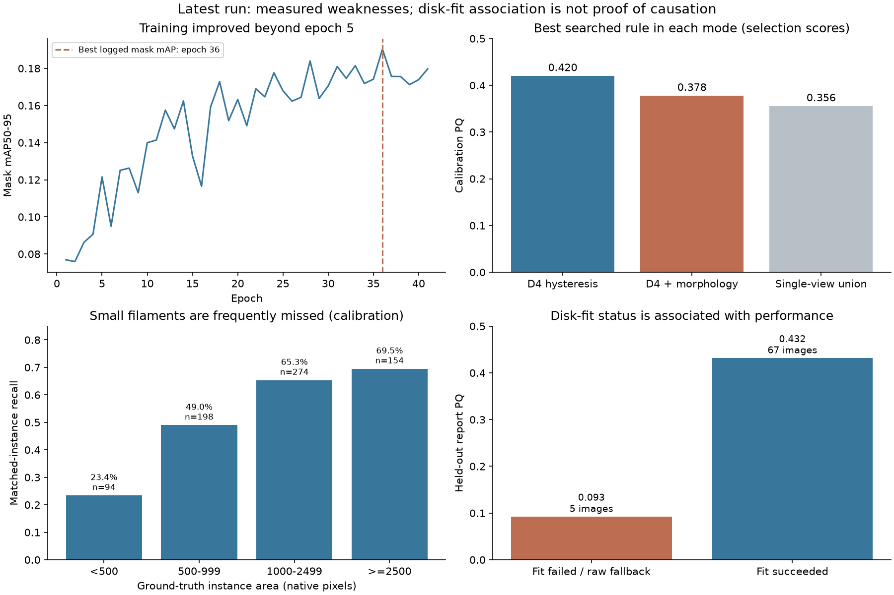

# Latest YOLO11 run: analysis of results.zip

Analyzed on 3 November 2026. Source: `Best/results.zip`, run `preprocessing_solar_union_v3_3c70ef0d51`. Only small metric/preview files were copied out; saved probability maps were read directly from the archive. No model was retrained, no test annotations were used, and no submission was changed.

**The archive shows a local/public generalization gap, along with measurable weaknesses on small filaments and disk-fit failures.** The earlier research priorities should be refined using these actual results. The new D4/hysteresis path is active and improves calibration performance; it should not be discarded on the assumption that it did nothing.

| Metric | Calibration | Held-out report | Public score, user-reported |
| --- | ---: | ---: | ---: |
| PQ | 0.4204 | 0.4234 | 0.33 |
| SQ | 0.6705 | 0.6651 | Unknown |
| RQ | 0.6269 | 0.6366 | Unknown |
| TP | 405 | 473 | Unknown |
| FP | 167 | 211 | Unknown |
| FN | 315 | 329 | Unknown |
| Physical images | 74 | 72 | Public subset not verified |
| Annotator views | 112 | 122 | Unknown |

On the report partition, count-based matched-instance precision is **69.2%**, and recall is **59.0%**: 329 of 802 annotated instances have no accepted match. These counts pool annotation views; the 684 prediction/view evaluations are not 684 distinct physical masks. There are 410 physical predicted instances across the 72 report images. Accepted matches have mean IoU 0.6651, so boundaries remain relevant as well as instance recognition.

Calibration and report PQ agree closely. That gives no indication of a large calibration-to-report collapse for this selected rule, although it does not prove hyperparameter selection is unbiased. A 5,000-resample bootstrap over report dates, retaining all their images and annotator views together, gives a conditional 95% interval of approximately **0.3944–0.4506**. This measures uncertainty within the report population; it is not an interval for the hidden public population or proof of a particular distribution shift. The observed report/public gap is approximately **0.0934**.

**The selected postprocessing really is the newer path.** The stored rule uses detection confidence 0.20, eight D4 views, pixel threshold 0.50, component peak above 0.90, mean probability at least 0.75 and area at least 200 pixels. Disk clipping is disabled. The following are the best searched configurations within each mode on calibration, all for the same saved checkpoint; they remain selection scores rather than independent report comparisons.

| Mode | Calibration PQ | TP | FP | FN |
| --- | ---: | ---: | ---: | ---: |
| D4 probability maps + hysteresis | 0.4204 | 405 | 167 | 315 |
| D4 + morphology-guided extraction | 0.3782 | 401 | 248 | 319 |
| Single-view binary union/components | 0.3558 | 331 | 182 | 389 |

The best D4/hysteresis configuration exceeds the best single-view candidate by **0.0645 calibration PQ**. This does not isolate TTA from filtering, because both differ. Morphological extraction adds false positives here and is not selected. This is evidence against adding more morphology blindly; it does not isolate or disprove the separate morphology enhancement applied to training images.

Lower confidence is not an automatic recall fix. Keeping the same hysteresis rule but reducing detection confidence from 0.20 to 0.10 raises TP from 405 to 451 and FP from 167 to 263. Calibration PQ falls slightly, from 0.4204 to 0.4181. Confidence 0.05 falls further to approximately 0.3963. Better masks and better quality ranking are more useful targets than simply admitting more candidates.

**Small-instance recall is directly weak.** I reconstructed the selected masks from every cached calibration map, scored them against the permitted training annotations, and reproduced the saved calibration PQ to numerical precision. This permits diagnosis without another forward pass or any retuning of report/test data.

| Ground-truth instance area | Instances | Matched | Recall |
| --- | ---: | ---: | ---: |
| Under 500 pixels | 94 | 22 | 23.4% |
| 500–999 pixels | 198 | 97 | 49.0% |
| 1,000–2,499 pixels | 274 | 179 | 65.3% |
| At least 2,500 pixels | 154 | 107 | 69.5% |

This supports foreground/size-aware sampling and a native-resolution mask model. It does not establish that model capacity alone causes the difference; contrast, annotation uncertainty, geometry and selection thresholds are confounded with size.

The 315 calibration false negatives can be split into reproducible diagnostic bins using the same thresholded components before and after quality filtering:

| Diagnostic bin | FN count | Meaning |
| --- | ---: | --- |
| A matching component was filtered | 77 | Before peak/mean/area filtering, some component had IoU >0.5; none survives with a qualifying match |
| Partial shape or grouping mismatch | 113 | Best unfiltered component IoU is >0.25 and ≤0.5 |
| Little matching-component support | 125 | Best unfiltered component IoU is ≤0.25 |

The 0.25 boundary is an analysis bin, not a competition threshold. The last two bins do not uniquely distinguish detector misses, weak mask probabilities and incorrect component grouping. About one quarter of FNs have a matching component removed by filters, but removing those filters can also admit many false positives; the calibration comparison above shows why a blanket relaxation is unwarranted.

The saved report's `one_to_many=0` and `many_to_one=0` do not prove there is no fragmentation or merging. In this notebook these counters use the above-0.5 hit matrix. Fragments that individually miss the IoU threshold can produce zeros in those counters. Structural diagnosis needs pixel-overlap/coverage analysis, not those counters alone.

**The disk-fit fallback is a concrete cohort to investigate.** I recomputed disk-fit success for all 887 supplied train/test images. The success/failure status matched all 94 cached metadata records where a saved comparison was available. The current `solar_preprocess` returns the original raw image immediately when fitting fails, so this switches off photometric normalization as well as geometry-dependent processing.

| Partition | Images | Disk fits failed |
| --- | ---: | ---: |
| Training | 561 | 48 (8.6%) |
| Calibration | 74 | 5 (6.8%) |
| Held-out report | 72 | 5 (6.9%) |
| Test | 180 | 20 (11.1%) |

| Report cohort | Images | PQ | TP | FP | FN |
| --- | ---: | ---: | ---: | ---: | ---: |
| Fit succeeded | 67 | 0.4319 | 470 | 210 | 299 |
| Fit failed, raw fallback | 5 | 0.0927 | 3 | 1 | 30 |

The failed-fit cohort is small and likely contains intrinsically difficult images, so these numbers do not prove the fallback causes the poor score. Nevertheless, the pipeline now has two input regimes and performs badly on one associated subset. A controlled test should keep safe photometric normalization available when precise geometry is uncertain, while skipping geometry-dependent corrections. Alternatively, a fully raw-input model provides an ablation. Any changed transform must be applied consistently in training and inference, with retraining and a new cache fingerprint; do not patch only test inference.

The test set has **16 zero-prediction images**. Of the 20 failed-fit images, 13 have zero predictions; among the 160 successful-fit images, only three have zero predictions. The former cohort contributes just 12 of the 1,005 total test masks. This is a strong association worth inspecting visually. It still gives no hidden-test recall measurement, and is not a reason to force one prediction per image.

The report has nine zero-prediction images, containing 30 annotated instances across their 13 views. Those account for only 30 of the 329 report FNs: most misses occur in images where some filaments are already detected. Overall prediction density is similar between report and test—**5.69 versus 5.58 masks per physical image**—so there is no evidence of a global count collapse at test inference.

**This was not a five-epoch training run.** The archive requested 100 epochs and contains 41 completed epoch rows. The strongest logged mask mAP50-95 is at epoch 36, followed by five non-improving epochs, consistent with `patience=5` early stopping. Mask mAP50-95 increased from 0.1216 at epoch five to 0.1904 at epoch 36. More training did improve that local training-validation measure, even though public gains remained small. The final logged learning rate is approximately 0.000658, so the planned 100-epoch cosine schedule had not reached its low-LR end. This is not evidence that merely extending the schedule will improve PQ; it does rule out describing the archived run as unchanged five-epoch optimization.

The archive contains both `best.pt` and `last.pt`, with different SHA256 hashes. However, the saved calibration table has 120 configurations for **only `best.pt`**, and no saved calibration evaluation for `last.pt`. Therefore, the archive does not substantiate the intended best-versus-last PQ comparison. Comparing both saved checkpoints on the same calibration protocol is a useful no-retraining experiment; it is not necessary to restore per-epoch postprocessing.

| Artifact | SHA256 |
| --- | --- |
| `best.pt` | `22aacac325c88412e78297f610c9b2f5083eda2144ae087934a1d70fd777b40b` |
| `last.pt` | `f333c90dc54bac90fba7aaca9902fecd78b9ba05b844090013a4ddd4b4833f71` |
| `a_submission.csv` | `93d0534092c9572c19fb42b6459f6c5174cc0e86a0a134a0e81fbd187a2940c6` |

The archived submission's hash matches `submission_audit.json`. I independently decoded and round-tripped all **1,005 native 2048 masks**, checked per-image non-overlap, verified unique IDs and matched row counts against the complete 180-image inference log. This rules out these file-format problems for the archived CSV. It cannot independently verify which file was uploaded to Kaggle; the user-reported 0.33 is assumed to correspond to this file.

**Refined next experiments.** Keep the validated D4/hysteresis candidate and use the existing split for controlled comparisons. First complete the saved best/last checkpoint comparison on calibration. For the next training experiment, make the raw-fallback/normalization issue explicit and test consistent inputs; do not mix this silently with a target-policy change. Restore the original annotator-specific supervision as a separate ablation. A native-resolution U-Net mask model, with small-filament-biased crops and YOLO instance proposals/ownership, remains the larger recommended change because the measured weak points now include small-object recall and mask/grouping mismatches. Simply adding morphology, lowering all thresholds or increasing the detector cap has little support from this archive.

The approximately 0.093 local/public gap remains unexplained causally. Test cohort difficulty, annotation density/style, sampling and differences between the published evaluator and hidden service are possible explanations, not findings established by these artifacts. The stronger evidence is the reproducible local error profile above. Repeated tuning on the held-out report would compromise its role; the extra component analysis used calibration only.

Machine-readable results are in `analysis_summary.json`, `calibration_instance_diagnostics.csv`, the grouped report CSVs and `disk_fit_status.csv`. `analyze_results_archive.py` reconstructs the selected calibration masks from the archive without executing notebook training cells, and `plot_latest_run.py` makes the figure. Small extracted source files retain their original contents. No entire archive extraction or new GPU training is needed for this analysis.
