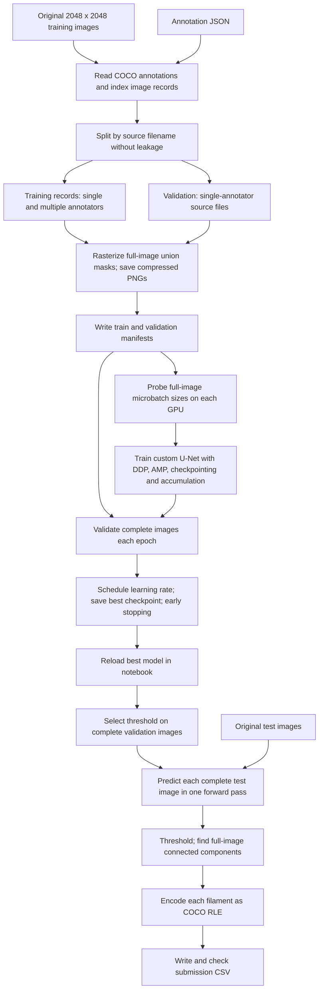
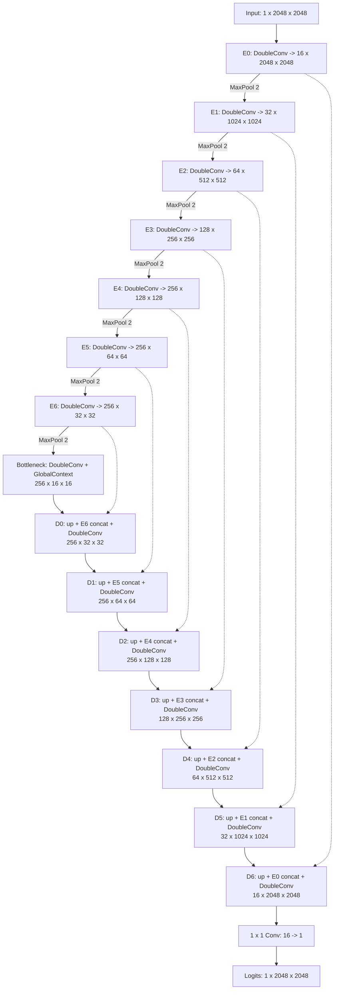
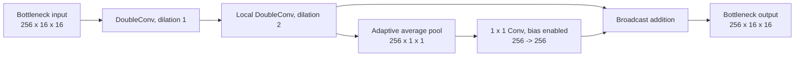
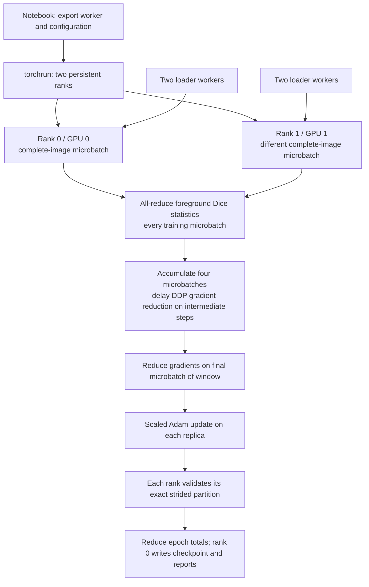

# Solar Filament Segmentation: Full-Image Custom U-Net Documentation

**Notebook:** [solar-filament-u-net-full-image.ipynb](solar-filament-u-net-full-image.ipynb)  
**Readable implementation:** [solar_unet_full_image_runtime.py](solar_unet_full_image_runtime.py)  
**Documentation date:** 2026-10-16, Japan time  
**Scope:** the implemented native-resolution experiment, including its data pipeline, custom model, training, validation, prediction, and submission generation.

The settings below describe the **notebook's configuration**. Its worker has some different fallback defaults when launched without that configuration; those differences are listed explicitly. Automatic batch size, the best epoch, and the selected prediction threshold are outputs of a training run, so they cannot be assigned final values before that run finishes.

## Contents

1. [Purpose and design](#1-purpose-and-design)
2. [Complete notebook pipeline](#2-complete-notebook-pipeline)
3. [Notebook cell map](#3-notebook-cell-map)
4. [Dataset, annotation masks, and split](#4-dataset-annotation-masks-and-split)
5. [Input preprocessing and augmentation](#5-input-preprocessing-and-augmentation)
6. [Custom U-Net architecture](#6-custom-u-net-architecture)
7. [Exact model parameter counts](#7-exact-model-parameter-counts)
8. [Training configuration](#8-training-configuration)
9. [GPU memory probe and resource management](#9-gpu-memory-probe-and-resource-management)
10. [Distributed training and gradient accumulation](#10-distributed-training-and-gradient-accumulation)
11. [Loss function](#11-loss-function)
12. [Validation, checkpoint selection, and scheduling](#12-validation-checkpoint-selection-and-scheduling)
13. [Prediction and threshold selection](#13-prediction-and-threshold-selection)
14. [Filament extraction and competition submission](#14-filament-extraction-and-competition-submission)
15. [Artifacts and checkpoint contents](#15-artifacts-and-checkpoint-contents)
16. [Running and maintaining the notebook](#16-running-and-maintaining-the-notebook)
17. [Verification and measured results](#17-verification-and-measured-results)
18. [Thin-filament considerations and current limits](#18-thin-filament-considerations-and-current-limits)
19. [Code navigation and references](#19-code-navigation-and-references)

## 1. Purpose and design

Solar filaments can be narrow, long, and curved. The earlier notebook divided a 2048 x 2048 image into sixteen 512 x 512 tiles, predicted each tile independently, thresholded those predictions, and stitched them together. A filament crossing a tile edge could receive inconsistent predictions on its two sides. The tile also excluded surrounding image context from that forward pass.

The new experiment presents **the complete 2048 x 2048 image to the model during both training and prediction**. Each training sample remains a complete image even when a GPU microbatch contains several samples. During final prediction, one forward call processes one complete image. Thresholding and connected-component extraction take place over the resulting complete probability map.

| Design choice | Implementation and purpose |
| --- | --- |
| Native input resolution | Preserve original image sampling for narrow structures; no image resizing or tile crops |
| Seven downsampling stages | Expand the hierarchy of spatial context, reaching a 16 x 16 bottleneck |
| Narrow early layers | Start with 16 channels to control the expensive high-resolution activation tensors |
| Capped deeper layers | Limit channel width to 256 rather than doubling it at every stage |
| Full-resolution skip connection | Feed learned 2048 x 2048 encoder features directly to the final decoder stage |
| Global bottleneck context | Add a projected whole-bottleneck summary to local dilated features |
| Small-batch normalization | Use GroupNorm in every convolution block |
| Memory-saving training | FP16 autocast, activation checkpointing, and gradient accumulation |
| Two-GPU execution | One full model replica and different complete images on each GPU |
| Full-image postprocessing | Extract components after prediction, allowing objects to cross the former tile grid |

The model is a **binary semantic segmentation model**: one foreground probability per pixel. It does not directly predict individual filament IDs. Filament instances are approximated afterward by connected components of the binary foreground mask.

The original [tiled notebook](solar-filament-u-net.ipynb) remains available for comparison.

## 2. Complete notebook pipeline

The diagrams use Mermaid, supported by GitHub and Markdown viewers with Mermaid rendering. The architecture tables also provide the complete structure as plain Markdown.



There are two validation decisions. **Epoch selection** chooses model weights using a combined validation loss with hard Dice at 0.5. **Threshold selection**, performed after training, chooses how to turn that selected model's probabilities into binary foreground.

## 3. Notebook cell map

Cell numbers below are **one-based notebook positions**, counting both Markdown and code cells. They are not execution counters.

| Cell | Type | Responsibility |
| --- | --- | --- |
| 1 | Markdown | Motivation, native-resolution design, hardware target, thin-structure safeguards |
| 2 | Code | Install `pycocotools`, `scikit-learn`, `pandas`, and `matplotlib` |
| 3 | Code | Imports, CPU thread limits, dataset discovery, paths, image size, random seed |
| 4 | Markdown | Explain the source-file split and annotator policy |
| 5 | Code | Load annotations, build indices, create the split, define mask rasterization |
| 6 | Markdown | Explain streaming images and compressed full-image mask caching |
| 7 | Code | Prepare mask PNGs and train/validation record manifests |
| 8 | Code | Show a complete annotated image and a 256 x 256 native-pixel detail view |
| 9 | Markdown | Explain training, memory probing, accumulation, and selection rules |
| 10 | Code | Set model/training constants, check CUDA and operating-system support |
| 11 | Code | Export and import the embedded, self-contained Python worker |
| 12 | Code | Write configuration; launch one persistent worker per GPU; stream logs |
| 13 | Code | Reload best checkpoint; reconstruct model; display history and learning curves |
| 14 | Markdown | Explain full-image threshold validation and component-PQ limitations |
| 15 | Code | Compute threshold candidates' Dice/PQ scores; save selected inference settings |
| 16 | Code | Define complete-image prediction and show full-frame/native-detail validation plots |
| 17 | Markdown | Explain component extraction, RLE submission format, and bounded processing |
| 18 | Code | Predict test images and generate the submission CSV |
| 19 | Code | Check CSV columns, duplicate IDs, and sample RLE decodability |
| 20 | Markdown | Describe outputs and link primary PyTorch documentation |

The 256 x 256 views in cells 8 and 16 are visualization crops only. They do not change training or prediction input size.

## 4. Dataset, annotation masks, and split

### 4.1 Expected files

```text
DATA_ROOT/
├── train/
│   ├── train_images/
│   │   └── original image files
│   └── MAGFiLO_1.0_Annotations_kaggle2026_train.json
└── test/
    └── test_images/
        └── original image files
```

`DATA_ROOT_OVERRIDE = None` enables automatic discovery. The notebook checks the current directory and its parents, recognizes the local `MAGFilo_1.0_Kaggle_2026`/`MAGFiLO_1.0_Kaggle_2026` folder names, and searches Kaggle inputs for the annotation file. Set the override to the dataset root when discovery does not match the environment.

All annotation records must declare height and width 2048. Original training images are also inspected before record preparation. Runtime loading rejects incorrectly sized image/mask pairs instead of resizing them.

### 4.2 Annotation-to-mask conversion

`polygons_to_mask(image_id)` creates a 2048 x 2048 binary union mask for the annotations associated with **that image ID**:

1. Allocate an all-background uint8 mask.
2. For polygon segmentations, reshape coordinates into point pairs, round them to integer pixel locations, and fill polygons with OpenCV.
3. For RLE segmentations, decode the mask with `pycocotools`; uncompressed RLE lists are converted first.
4. Combine foreground regions into the binary mask.
5. Save the mask PNG with background 0 and foreground 255.

This preserves the baseline's polygon rasterization convention. Annotation IDs sharing a filename remain separate records; their masks are **not merged across annotators**. An image record's mask combines all its listed segmentation regions without a category-specific filter.

### 4.3 Source-file split

| Setting | Value |
| --- | --- |
| Validation target | 20% of unique source filenames, rounded, with a minimum of one |
| Split seed | 10 |
| Validation candidates | Source files represented by exactly one annotation image record |
| Multiple-annotator sources | All their image records remain in training |
| Leakage check | Training and validation filename sets must be disjoint |

Validation size is capped at one less than the number of single-annotator candidates. This leaves at least one such candidate for training.

The inspected local dataset contains:

| Quantity | Count |
| --- | ---: |
| Annotation image records | 1,154 |
| Object annotation entries | 8,199 |
| Unique source filenames | 707 |
| Training annotation records | 1,013 |
| Unique training source files | 566 |
| Validation records/source files | 141 |

These are properties of the inspected dataset snapshot, not hardcoded sample counts. The notebook recomputes them when run. Multiple records of one training source give that source additional sampling weight, matching the existing experiment's label policy.

### 4.4 Mask cache and record manifests

Masks are stored under:

```text
unet_full_image_outputs/masks/<annotation-fingerprint>/<image-id-hash>.png
```

The directory fingerprint is the first 16 hexadecimal characters of SHA-256 over the annotation bytes and the mask-policy version string `full-image-cv2-union-v1`. The PNG filename hashes the annotation image ID. Changed annotations therefore select a different cache directory. Missing masks are generated; existing files are reused and validated when loaded by the dataset.

Original images are referenced by path and are not duplicated into a grayscale cache. Each record stores `image_path`, `mask_path`, `image_id`, and `file_name`. Both split lists are written to `split_manifest.json`.

## 5. Input preprocessing and augmentation

### 5.1 Dataset contract

`FullImageDataset` reads an image directly as grayscale and its mask without a color conversion. Each must decode to uint8 with shape `(2048, 2048)`. Mask values must be exclusively 0 or 255.

| Point in pipeline | Image | Mask |
| --- | --- | --- |
| On disk/after decoding | uint8, `2048 x 2048`, values 0–255 | uint8, `2048 x 2048`, values 0 or 255 |
| Returned by dataset | uint8, `1 x 2048 x 2048` | uint8, `1 x 2048 x 2048`, values 0 or 1 |
| After batching | `B x 1 x 2048 x 2048` | `B x 1 x 2048 x 2048` |
| On GPU before forward | float32, scaled by division by 255 | float32, values 0 or 1 |
| Model output | Raw logits, `B x 1 x 2048 x 2048` | Used as loss target |

There is no mean/std normalization, CLAHE, contrast inversion, or intensity augmentation in this implementation. Channels-last changes memory layout; the logical tensor shape remains BCHW. The forward pass uses autocast for supported operations, while the stored model parameters remain FP32.

### 5.2 Training augmentation

| Transform | Selection |
| --- | --- |
| Horizontal flip | Independent probability 0.5 |
| Vertical flip | Independent probability 0.5 |
| Rotation | Uniformly select 0, 1, 2, or 3 quarter turns |

Identical transforms are applied to image and mask. Flips and right-angle rotations rearrange pixels without interpolating them. Arrays are copied into contiguous writable memory before becoming Torch tensors.

Validation and prediction use the original image geometry. There are no random crops, tile crops, arbitrary-angle rotations, resized training images, or test-time augmentation.

## 6. Custom U-Net architecture

### 6.1 Model constructor

```python
FullImageUNet(
    in_channels=1,
    out_channels=1,
    base_channels=16,
    depth=7,
    max_channels=256,
    checkpoint_blocks=True,
)
```

Channel widths are constructed as `min(base_channels * 2**i, max_channels)` for `i = 0 ... depth`. For the notebook configuration, this produces:

```text
[16, 32, 64, 128, 256, 256, 256, 256]
 └──────── seven encoder widths ─────┘   bottleneck width
```

The first seven values supply encoder blocks; the last value supplies the bottleneck. The model is initialized from PyTorch's layer defaults and trained from scratch.

### 6.2 Architecture diagram

Shapes below omit batch size and use **channels x height x width**. Dashed arrows are skip connections. E0–E6 and D0–D6 match the runtime's zero-based module indices.



The model's forward method accepts BCHW tensors with spatial dimensions divisible by `2**depth`, or 128 for depth seven. This permits small synthetic regression tests. The notebook's training dataset and prediction helper enforce native 2048-square images.

### 6.3 DoubleConv block

```text
Input
  -> Conv2d(Cin, Cout, kernel=3, stride=1, padding=d, dilation=d, bias=False)
  -> GroupNorm(groups=gcd(8, Cout), channels=Cout, eps=1e-5, affine=True)
  -> ReLU(inplace=False)
  -> Conv2d(Cout, Cout, kernel=3, stride=1, padding=d, dilation=d, bias=False)
  -> GroupNorm(groups=gcd(8, Cout), channels=Cout, eps=1e-5, affine=True)
  -> ReLU(inplace=False)
```

Ordinary blocks use dilation `d=1`, keeping their spatial size. Every normalization layer in the default architecture has eight groups. For channels 16, 32, 64, 128, and 256, each group contains 2, 4, 8, 16, and 32 channels respectively. GroupNorm's affine weights and biases are trainable.

GroupNorm uses input statistics in training and evaluation. It avoids BatchNorm running-statistic updates during checkpoint recomputation. There are no BatchNorm or dropout layers. See the primary [GroupNorm reference](https://docs.pytorch.org/docs/2.14/generated/torch.nn.GroupNorm.html).

### 6.4 Encoder and pooling

Each encoder computes its full stage features, saves that tensor as a skip, and then performs functional `max_pool2d(kernel_size=2, stride=2)`.

| Stage | Input channels | Output channels | Output spatial size | Following pool output |
| --- | ---: | ---: | --- | --- |
| E0 | 1 | 16 | 2048 x 2048 | 1024 x 1024 |
| E1 | 16 | 32 | 1024 x 1024 | 512 x 512 |
| E2 | 32 | 64 | 512 x 512 | 256 x 256 |
| E3 | 64 | 128 | 256 x 256 | 128 x 128 |
| E4 | 128 | 256 | 128 x 128 | 64 x 64 |
| E5 | 256 | 256 | 64 x 64 | 32 x 32 |
| E6 | 256 | 256 | 32 x 32 | 16 x 16 |

The full-resolution E0 features provide a fine-detail route to the final decoder even though the deeper path is repeatedly downsampled.

### 6.5 Bottleneck and global context

The complete bottleneck consists of:

1. An ordinary `DoubleConv(256, 256)` at 16 x 16.
2. `GlobalContext(256)` at the same resolution.



The dilated block uses two 3 x 3 convolutions with dilation and padding two. The pooled branch averages the local bottleneck features over their complete spatial extent, projects the summary, and broadcasts it back into the local map by addition.

This adds a global image summary to local features. It is not attention or an explicit algorithm for tracing or joining filament centerlines.

### 6.6 Decoder stages

Each stage performs:

```text
Previous decoder/bottleneck features
  -> ConvTranspose2d(Cin, Cskip, kernel=2, stride=2, padding=0,
                     output_padding=0, bias=True)
  -> concatenate matching encoder skip along the channel dimension
  -> DoubleConv(2 * Cskip, Cskip)
```

The exact input/output sizes match, so no resizing or cropping is needed to align skips.

| Stage | Input features | Upsampled features | Skip | Channels after concatenation | Output features |
| --- | --- | --- | --- | ---: | --- |
| D0 | 256 @ 16 x 16 | 256 @ 32 x 32 | E6 | 512 | 256 @ 32 x 32 |
| D1 | 256 @ 32 x 32 | 256 @ 64 x 64 | E5 | 512 | 256 @ 64 x 64 |
| D2 | 256 @ 64 x 64 | 256 @ 128 x 128 | E4 | 512 | 256 @ 128 x 128 |
| D3 | 256 @ 128 x 128 | 128 @ 256 x 256 | E3 | 256 | 128 @ 256 x 256 |
| D4 | 128 @ 256 x 256 | 64 @ 512 x 512 | E2 | 128 | 64 @ 512 x 512 |
| D5 | 64 @ 512 x 512 | 32 @ 1024 x 1024 | E1 | 64 | 32 @ 1024 x 1024 |
| D6 | 32 @ 1024 x 1024 | 16 @ 2048 x 2048 | E0 | 32 | 16 @ 2048 x 2048 |

### 6.7 Output and activation checkpointing

The output head is a biased 1 x 1 convolution from 16 channels to one. It returns **logits**. Sigmoid is applied in the loss calculation and prediction helper, not stored inside the output head.

Checkpointing wraps seven encoder blocks, the complete bottleneck, and seven complete decoder stages: **15 boundaries**. A decoder checkpoint includes its transposed convolution, concatenation, and DoubleConv. Intermediate activations inside these regions can be recomputed during backward; skip outputs still have to remain available.

The implementation calls `checkpoint(..., use_reentrant=False)` only when checkpointing is enabled, the model is training, and autograd is enabled. Evaluation and prediction do not use checkpoint recomputation. This trades additional computation for reduced saved-activation memory; see [PyTorch activation checkpointing](https://docs.pytorch.org/docs/2.14/checkpoint.html).

## 7. Exact model parameter counts

Counts below include convolution biases where present and GroupNorm affine parameters. They were verified by instantiating the configured model in PyTorch. All model parameters are trainable.

### 7.1 Encoder and bottleneck

| Module | Trainable parameters |
| --- | ---: |
| `encoders.0` / E0 | 2,512 |
| `encoders.1` / E1 | 13,952 |
| `encoders.2` / E2 | 55,552 |
| `encoders.3` / E3 | 221,696 |
| `encoders.4` / E4 | 885,760 |
| `encoders.5` / E5 | 1,180,672 |
| `encoders.6` / E6 | 1,180,672 |
| **Encoder subtotal** | **3,540,816** |
| Initial bottleneck DoubleConv | 1,180,672 |
| GlobalContext dilated DoubleConv | 1,180,672 |
| GlobalContext 1 x 1 projection | 65,792 |
| **Complete bottleneck subtotal** | **2,427,136** |

### 7.2 Decoder and output

| Module | Transposed convolution | DoubleConv | Stage total |
| --- | ---: | ---: | ---: |
| `decoders.0` / D0 | 262,400 | 1,770,496 | 2,032,896 |
| `decoders.1` / D1 | 262,400 | 1,770,496 | 2,032,896 |
| `decoders.2` / D2 | 262,400 | 1,770,496 | 2,032,896 |
| `decoders.3` / D3 | 131,200 | 442,880 | 574,080 |
| `decoders.4` / D4 | 32,832 | 110,848 | 143,680 |
| `decoders.5` / D5 | 8,224 | 27,776 | 36,000 |
| `decoders.6` / D6 | 2,064 | 6,976 | 9,040 |
| **Decoder subtotal** | | | **6,861,488** |
| Output 1 x 1 convolution | | | **17** |

**Grand total: 12,829,457 trainable parameters.**

The model contains 34 Conv2d layers: 32 block convolutions, one global projection, and one output convolution. It also contains seven ConvTranspose2d layers, 32 GroupNorm layers, 32 ReLUs, seven functional max-pools, and one adaptive average-pooling operation. “Depth seven” means seven downsampling stages, not seven total convolution layers.

For an ordinary DoubleConv with input channels `a` and output channels `b`, the parameter count is `9ab + 9b² + 4b`. A transposed convolution from `a` to `b` has `4ab + b` parameters. These formulas explain the table values.

FP32 parameters, gradients, and the two Adam moment arrays together are approximately 0.191 GiB, excluding temporary tensors and other state. Saved feature maps and convolution workspaces are the larger memory concern at native resolution. A single 16-channel 2048 x 2048 feature map alone occupies 128 MiB at FP16 or 256 MiB at FP32.

## 8. Training configuration

### 8.1 Active notebook settings

| Parameter | Configured value |
| --- | --- |
| Image size | 2048 x 2048 |
| Input/output channels | 1 / 1 |
| `BASE_CHANNELS` | 16 |
| `DEPTH` | 7 |
| `MAX_CHANNELS` | 256 |
| `checkpoint_blocks` | `True` |
| Initialization | From scratch; no pretrained encoder |
| `RANDOM_SEED` | 10 |
| `NUM_EPOCHS` | 100 maximum |
| `EARLY_STOPPING_PATIENCE` | 10 non-improving epochs |
| Optimizer | `torch.optim.Adam` |
| `LEARNING_RATE` | `3e-4` / 0.0003 |
| `WEIGHT_DECAY` | `1e-4` / 0.0001 |
| Adam betas / epsilon | `(0.9, 0.999)` / `1e-8` |
| Adam AMSGrad / foreach | `False` / explicitly `False` |
| Weight decay behavior | Standard Adam/L2; decoupled weight decay is not enabled |
| `PER_GPU_BATCH_SIZE` | `"auto"` |
| Batch probe candidates | 1, 2, 3, and 4 complete images per GPU |
| `GRADIENT_ACCUMULATION_STEPS` | 4 |
| Maximum GPU count | `min(2, torch.cuda.device_count())` |
| `MEMORY_FRACTION` | 0.85 |
| `NUM_WORKERS` | 4 total training loader workers |
| Training loader prefetch factor | 1 per worker |
| Validation loader workers | 0 per rank |
| Persistent training workers | Enabled when worker count is nonzero |
| Worker process start method | `spawn` |
| Pinned host memory | Enabled |
| FP16 autocast / GradScaler | Enabled |
| Channels-last layout | Enabled |
| cuDNN exhaustive benchmarking | Disabled |
| Progress logging | Every 10 batches on rank 0 |
| Loss weights | Union-PQ 0.4, Dice 0.4, BCE 0.2 |
| Gradient clipping | Not applied |

Adam defaults listed here were checked in the local PyTorch 2.14.1 environment. The worker explicitly supplies learning rate, weight decay, and `foreach=False`; it does not select fused Adam. The notebook relies on the environment's existing CUDA-enabled Torch installation rather than installing or pinning Torch in its package-install cell.

### 8.2 Notebook settings versus standalone worker fallbacks

Launching `train(config)` with missing keys uses worker fallback values. The notebook writes the active values explicitly:

| Setting | Notebook | Worker fallback if absent |
| --- | --- | --- |
| Seed | 10 | 42 |
| Epoch limit | 100 | 30 |
| Early-stopping patience | 10 | 6 |
| Learning rate | `3e-4` | `1e-4` |
| Weight decay | `1e-4` | `1e-5` |
| Per-GPU batch | `"auto"` | 1 |
| Candidates if automatic | `[1, 2, 3, 4]` | `[1, 2]` when candidates are omitted |
| Logging interval | 10 | 20 |

A requested batch and the batch ultimately selected are different concepts. Read `runtime_report.json` or the saved checkpoint for the selected batch. Likewise, 100 is the epoch limit, not evidence that 100 epochs have already been run.

## 9. GPU memory probe and resource management

### 9.1 What the startup probe measures

Before wrapping the model with DDP, each rank independently tries the candidate batches using its own GPU. Every trial uses synthetic native-size inputs and approximately 2% foreground targets, actual loss computation, backward, and Adam updates. Allocating Adam state is necessary for the trial to represent optimizer memory as well as forward/backward memory.

The normal probe uses two warmup steps followed by two timed steps for each candidate. It uses FP16 autocast and an initial GradScaler scale of 1024. The training scaler is newly created afterward with PyTorch's default initial scale, 65536 in the verified environment.

For each trial, the worker records peak allocated bytes, peak reserved bytes, device total memory, available headroom, median timed step duration, and estimated images/second. CUDA OOM is caught locally. Trials do not call a DDP forward or distributed loss collective. Results are gathered across ranks after local handling and cleanup.

### 9.2 Acceptance and selection rules

```text
budget = 0.85 * device_total_memory
DDP_margin = max(384 MiB, 2 * FP32_parameter_bytes)

candidate fits when:
    peak_allocated <= budget
    AND peak_reserved <= budget
    AND available_headroom >= DDP_margin
```

Headroom is conservatively estimated from both CUDA free memory after the trial and the extra reservation relative to the trial baseline. A candidate is feasible only if it passes on **every participating GPU**.

For automatic selection:

```text
estimated_global_images_per_second
    = candidate_batch * GPU_count / slowest_GPU_median_step_seconds
```

The worker selects the feasible candidate with the best estimate, rather than automatically choosing the largest fitting batch. This timing does not include real data loading or DDP training communication, so actual epoch throughput remains the useful final measurement. Initial model state and CPU, CUDA, Python, and NumPy random states are restored between candidates and after probing.

If an integer batch is requested, the worker probes that batch and batch one; it can fall back to one. If no candidate fits, it stops with a configuration error. It does not silently resize images or switch back to tiles.

### 9.3 GPU and host-memory behavior

Two 14 GiB GPUs provide **two separate 14 GiB budgets** in this DDP setup. Each stores a full model replica, gradients, optimizer state, and its local activations. They do not become a single 28 GiB memory space. See the primary [DDP documentation](https://docs.pytorch.org/docs/2.14/generated/torch.nn.parallel.DistributedDataParallel.html).

Activation checkpointing reduces stored intermediates; AMP reduces many activation and compute costs; accumulation increases the number of images contributing to an update without retaining four complete forward graphs at once. Loss reductions remain FP32 for numerical stability.

Images and masks are queued as uint8. One complete grayscale image/mask pair uses about 8 MiB before decoding/copy overhead. Four workers with prefetch one queue roughly `32 * batch_size` MiB of pair arrays across the training loaders, plus active samples and process overhead. The entire dataset is not copied into each worker.

The implementation sets Torch/OpenCV threads and OMP/MKL/OpenBLAS thread counts to one per process. With two GPU ranks, the four loader workers are split two per rank. This is a resource budget, **not a hard single-CPU affinity or 30 GB RAM limit**. CPU decoding and disk I/O can still limit GPU utilization. The runtime logs image throughput and per-GPU peak allocated/reserved memory; it does not currently log loader-wait durations or peak host RAM.

## 10. Distributed training and gradient accumulation

### 10.1 Process layout



Two-GPU training uses NCCL and requires Linux/Kaggle or a suitable Linux environment. Native Windows is supported for a single-GPU smoke run; the two-GPU path is explicitly rejected there. The launcher preserves an existing CUDA visibility mask and selects at most two visible devices.

DDP is constructed with `broadcast_buffers=False` and `gradient_as_bucket_view=True`. A distributed training sampler shuffles with a fixed seed and `set_epoch(epoch)`. `drop_last=False` may repeat up to `GPU_count - 1` training records so rank lengths match. In this snapshot, 1,013 records on two ranks produce 507 sampler entries per rank, totaling 1,014 entries for that epoch.

At the start of distributed training, `initialize_gradient_buffers()` creates missing gradients with exactly the corresponding parameter strides using `torch.empty_strided`. Distributed update windows clear these buffers with `zero_grad(set_to_none=False)`, retaining their layouts and established DDP bucket views. Existing buffers are preserved at later epoch boundaries. This addresses the channels-last 1 x 1 kernel warning where gradient strides such as `[256, 1, 1, 1]` differ from the bucket's `[256, 1, 256, 256]`, despite representing equivalent singleton-dimension layouts. Probe cleanup and single-process training still use `set_to_none=True`. The approach follows [PyTorch 2.11 manual gradient layouts](https://docs.pytorch.org/docs/2.11/autograd.html#manual-gradient-layouts). It changes gradient storage, not the loss or accumulation weights.

Validation uses the strided indices `rank, rank + world_size, ...`, with no padding or repeated validation examples. The unwrapped module performs validation, allowing ranks to finish different numbers of batches before the final metric reductions.

### 10.2 Effective batch and final windows

```text
Nominal effective batch = per-GPU microbatch * GPU count * accumulation steps
```

| Selected microbatch per GPU | Two-GPU nominal effective batch with accumulation 4 |
| --- | ---: |
| 1 | 8 images |
| 2 | 16 images |
| 3 | 24 images |
| 4 | 32 images |

Gradients are zeroed at the start of an update window. Each microbatch loss is multiplied by `images_in_microbatch / actual_images_in_window` before backward. The final window can contain fewer than four microbatches, and the final microbatch can contain fewer samples; their weights use the actual sample count.

Intermediate microbatches run inside DDP `no_sync()`. Gradient synchronization occurs on the final microbatch of the window, followed by `scaler.step(optimizer)`, `scaler.update()`, and gradient clearing. The separate global-Dice statistic all-reduce still happens every training microbatch.

The gradients therefore average the individual microbatch objectives. In particular, the Dice component is **not** recomputed as one Dice ratio over all images in the accumulated effective batch. PyTorch's [AMP examples](https://docs.pytorch.org/docs/2.14/notes/amp_examples.html) describe the interaction between gradient scaling and accumulation.

## 11. Loss function

The worker computes a weighted combination of a smooth union-overlap surrogate, foreground Dice loss, and pixel binary cross entropy:

```text
L_total = 0.4 * L_union_PQ + 0.4 * (1 - D_soft) + 0.2 * L_BCE
```

All three calculations run in FP32, outside autocast. The model supplies logits `z`; `p = sigmoid(z)` supplies probabilities. Targets `y` are binary.

### 11.1 Union-PQ surrogate

For each image:

```text
I = sum(p * y)        soft intersection
P = sum(p)            predicted foreground area
T = sum(y)            target foreground area
s = 1.0              smoothing constant

soft_SQ = (I + s) / (P + T - I + s)
soft_RQ = (2*I + s) / (P + T + s)

If T > 0:
    image_loss = -0.5 * [log(max(soft_SQ, 1e-6)) + log(max(soft_RQ, 1e-6))]
If T == 0:
    image_loss = P / (H * W)

L_union_PQ = mean(image_loss over the local microbatch)
```

Despite the variable name `log_soft_pq`, this calculation operates on binary union masks. It performs no instance matching or connected-component counting and is not the competition's exact instance Panoptic Quality.

### 11.2 Foreground Dice

```text
D_soft = (2 * sum(I) + 1) / (sum(P) + sum(T) + 1)
```

During distributed training, the sums include the current microbatch from every rank. The implementation all-reduces detached sufficient statistics and uses a world-size-scaled local gradient correction so DDP's gradient averaging yields the global-microbatch Dice gradient.

During validation, soft intersection and area totals are accumulated for the complete validation set and reduced once at epoch end. This avoids averaging per-batch Dice ratios in the final validation metric.

### 11.3 Binary cross entropy

`binary_cross_entropy_with_logits(logits, targets)` uses its mean reduction. It is unweighted: no `pos_weight` or separate foreground/background class cost is configured. BCE provides a useful gradient for confident mistakes while the overlap terms emphasize foreground agreement.

There is no skeleton, clDice, boundary, explicit connectivity, or instance embedding loss in the current model. Such losses would be separate experiments, with their memory costs and validation effects measured explicitly.

## 12. Validation, checkpoint selection, and scheduling

Every epoch runs complete-image validation without augmentation or autograd. The runtime aggregates:

| Metric | Meaning |
| --- | --- |
| `log_soft_pq_loss` | Sample-averaged union-PQ surrogate |
| `bce_loss` | Sample-averaged BCE; image sizes are equal |
| `soft_dice` | Whole-validation-set foreground Dice from probability totals |
| `dice_at_0_5` | Whole-validation-set Dice after thresholding logits at zero |
| `loss` | Weighted combination using whole-set soft Dice |
| `selection_loss` | Weighted combination using whole-set hard Dice at 0.5 |

```text
hard_prediction = (logits >= 0)       equivalent to probability >= 0.5

D_hard = (2 * hard_intersection + 1) / (predicted_pixels + target_pixels + 1)

validation_loss
    = 0.4 * average_union_PQ_loss + 0.4 * (1 - D_soft) + 0.2 * average_BCE

selection_loss
    = 0.4 * average_union_PQ_loss + 0.4 * (1 - D_hard) + 0.2 * average_BCE
```

Hard-Dice validation here uses raw thresholded predictions, before the later optional component-area filter. Training logs sample-weighted means of microbatch losses and soft Dice. Training hard Dice is left as NaN to avoid additional reductions.

The checkpoint improves when `selection_loss < best_selection_loss - 1e-5`. An improvement saves the model and resets the stale counter; ten consecutive non-improving epochs trigger early stopping.

| Scheduler setting | Value |
| --- | --- |
| Scheduler | `ReduceLROnPlateau` |
| Monitored quantity | Validation `selection_loss` |
| Mode | `min` |
| Reduction factor | 0.5 |
| Patience | 2 |
| Minimum learning rate | `1e-6` |
| Threshold/default threshold mode | `1e-4` / relative |
| Cooldown / epsilon | 0 / `1e-8` |

The scheduler's default relative-improvement rule differs slightly from the checkpoint's absolute `1e-5` rule. The best checkpoint contains inference weights and metadata; it does not contain optimizer, scheduler, or GradScaler state for exact training resumption.

## 13. Prediction and threshold selection

### 13.1 Full-image prediction contract

`predict_full_image(model, image, device, amp=True, channels_last=True)` performs:

```text
uint8 grayscale image [2048, 2048]
  -> validate native shape and divisibility
  -> tensor [1, 1, 2048, 2048], float32 / 255
  -> model.eval() and inference_mode()
  -> one full-image forward under FP16 autocast
  -> logits [1, 1, 2048, 2048]
  -> FP32 sigmoid
  -> float32 NumPy probability map [2048, 2048]
```

Prediction runs on GPU 0 with batch one. **Both GPUs are used for training; validation threshold search and test submission inference in the notebook use one GPU.** There is no tile loop, stitching, external input padding, image resize, model ensemble, or test-time augmentation in this prediction path. The convolution blocks themselves use padding as described in the architecture section.

The native input contract rejects 512-square tiles. Model configuration is reconstructed from `checkpoint["model_config"]`, and `model_state_dict` is loaded without a DDP `module.` prefix. The notebook loads on CPU with `weights_only=True`, transfers to GPU, restores the configured memory format, and calls evaluation mode.

### 13.2 Inference settings

| Parameter | Value |
| --- | --- |
| Image size / batch | 2048 x 2048 / one complete image |
| Device | `cuda:0` |
| FP16 forward | Enabled by `AMP_ENABLED` |
| Probability output | FP32 sigmoid map |
| Threshold candidates | 0.20, 0.30, 0.40, 0.50, 0.60, 0.70 |
| Final threshold | Selected from full-image validation; not fixed in advance |
| Minimum predicted component area | 1 pixel by default |
| Component connectivity | 8-neighbor |
| PQ component match | Strict IoU greater than 0.50 |
| Morphological closing/opening | Not applied |
| TTA / prediction augmentation | Not applied |

### 13.3 Full-image threshold search

For each validation image, the notebook predicts its probability map once and reuses it for all thresholds. For each threshold it extracts complete-image predicted components, applies the configured area filter, and accumulates both filtered pixel statistics and component matches. Ground-truth components retain every annotated foreground pixel.

Component intersections are computed with sparse unique label-pair counts rather than allocating a dense matrix over all predicted/target component pairs. For disjoint component maps, strict IoU greater than 0.5 gives unique matches. Changing the match threshold below 0.5 would require explicit one-to-one matching logic.

```text
PQ_component = sum(IoU of matches) / (TP + 0.5*FP + 0.5*FN)

Dice_pixel = (2*intersection + 1) / (predicted_pixels + target_pixels + 1)

joint_score = 2 * PQ_component * Dice_pixel / (PQ_component + Dice_pixel)
```

An empty PQ denominator is scored as one; a zero sum in the joint-score denominator produces joint score zero. Pixel Dice and PQ counts are pooled over all validation images.

Candidates sort by joint score, then component PQ, then pixel Dice, all descending, then threshold ascending as the final tie-break. The winning value becomes `BEST_THRESHOLD` and is saved with image size and minimum component area in `inference_settings.json`.

This component PQ is a **proxy** built from the annotation union masks. Touching annotated instances can merge into one target component, so it need not equal a polygon-instance competition metric. Inspect native-detail plots as well as the aggregate scores.

`predict_full_resolution()` wraps the probability helper, checks that the chosen threshold is between zero and one, thresholds the complete image, applies the same area filter, and returns a boolean 2048-square mask.

## 14. Filament extraction and competition submission

After full-image thresholding:

1. Label foreground with OpenCV 8-connected components.
2. Keep components with area at least `MIN_COMPONENT_AREA`.
3. Order components by descending area; ties retain their component scan order.
4. Generate IDs `<test_filename_stem>_<one_based_component_index>`.
5. Encode one component at a time with COCO compressed RLE using a Fortran-contiguous uint8 mask.
6. Stream rows to the CSV.

```csv
filament_id,segmentation_rle
<image_stem>_1,<COCO_compressed_RLE_counts>
<image_stem>_2,<COCO_compressed_RLE_counts>
```

`CREATE_SUBMISSION = True` enables generation. Input test extensions are `.jpg`, `.jpeg`, and `.png`, sorted by filename. Each image must decode as a native 2048-square grayscale image. Duplicate filename stems are rejected before inference, because their generated filament IDs would collide.

Empty predictions produce no filament rows, following the existing notebook's convention. Components are encoded iteratively, avoiding a list containing one full-frame mask for every object. The final check verifies exact column names, nonempty IDs/RLE values, unique filament IDs, and decodes up to three sample RLEs to nonempty 2048-square masks. It does not replace competition-side evaluation.

Eight-connectivity treats diagonally touching pixels as connected. This can preserve diagonal narrow filaments, but two distinct filaments that touch can also become one predicted instance. No separate instance-separation head is present.

## 15. Artifacts and checkpoint contents

```text
unet_full_image_outputs/
├── masks/<fingerprint>/<image-id-hash>.png
├── split_manifest.json
├── solar_unet_full_image_runtime.py
├── training_config.json
├── distributed_training.log
├── full_image_unet_best.pth
├── training_history.csv
├── runtime_report.json
├── threshold_validation.csv
├── inference_settings.json
└── solar_filament_full_image_submission.csv
```

| Artifact | Contents |
| --- | --- |
| `split_manifest.json` | Train/validation paths, annotation IDs, filenames, and image size |
| Exported runtime `.py` | Exact worker embedded in the notebook |
| `training_config.json` | Explicit notebook settings and record manifests supplied to workers |
| `distributed_training.log` | Worker console output, probe results, progress and errors |
| `full_image_unet_best.pth` | Best model weights and inference-relevant training/architecture metadata |
| `training_history.csv` | Per-epoch losses, Dice, learning rate, timing, throughput, peak-memory summaries |
| `runtime_report.json` | GPU identities, architecture, chosen batch, probe trials, worker configuration, per-rank epoch memory |
| `threshold_validation.csv` | Scores and TP/FP/FN for every candidate threshold |
| `inference_settings.json` | Selected threshold, minimum component area, native image size |
| Submission CSV | Filament IDs and compressed COCO RLE counts |

The checkpoint keys include:

```text
model_state_dict
model_config: in_channels, out_channels, base_channels, depth,
              max_channels, checkpoint_blocks
image_size
epoch
loss_weights
num_gpus
per_gpu_batch_size
gradient_accumulation_steps
channels_last
amp
val_loss
val_log_soft_pq_loss
val_soft_dice
val_bce_loss
val_dice_at_0_5
val_selection_loss
```

The history contains each split's loss, log-soft-PQ loss, soft Dice, BCE, and hard Dice fields, plus validation selection loss, learning rate, training/validation seconds, images/second, and maximum per-rank peak allocated/reserved GiB. The recorded learning rate is the value after that epoch's scheduler step. Distributed throughput uses total processed samples divided by the slowest rank's epoch duration. Training hard Dice is NaN by design.

Threshold settings are saved separately after the best model is loaded; they are not embedded back into the `.pth` checkpoint. Copy `inference_settings.json` along with the checkpoint when deploying the selected decision rule. Record paths in the training configuration are absolute to the run environment and must be regenerated or updated after moving the dataset.

## 16. Running and maintaining the notebook

### 16.1 Normal two-GPU run

1. Open the full-image notebook in a CUDA-enabled Python environment. On Kaggle, enable both available GPUs before starting.
2. Confirm the dataset is mounted or set `DATA_ROOT_OVERRIDE`.
3. Run the cells in order. Mask preparation can reuse the annotation-versioned cache.
4. Check the listed GPU identities, memory probe results, selected batch, and four-worker budget.
5. Let distributed training finish; inspect validation curves and the actual per-GPU memory report.
6. Run threshold selection and inspect complete-image/native-detail validation predictions.
7. Generate the submission and run its schema/RLE check.

The worker script is embedded, so uploading the notebook alone is sufficient. Its package cell installs supporting libraries; the environment must already provide a compatible CUDA Torch build, NumPy, OpenCV, and PIL/Pillow. The default system Python on the inspected machine was CPU-only; the project's `.venv` contained the CUDA-enabled Torch used for verification.

Training is launched through subprocesses rather than notebook-local multiprocessing of a model object. This gives each GPU a persistent worker. Standard output is shown and saved. Interrupt cleanup terminates the launched process group on Linux or the launched process on Windows.

### 16.2 Resource adjustments

| Situation | Adjustment |
| --- | --- |
| Need a conservative initial run | Set `PER_GPU_BATCH_SIZE = 1` |
| Full-frame batch one still fails | Reduce base width, for example to 8; retain AMP and checkpointing |
| GPUs have ample capacity | Compare wider bases such as 24 or 32; rerun the memory probe and validation |
| Host decoding is the bottleneck | Inspect image throughput and storage/CPU load; compare worker counts within the four-worker budget |
| Need a different effective batch | Change accumulation steps, then consider the resulting optimization behavior |
| Too many tiny false positives | Evaluate a larger `MIN_COMPONENT_AREA` on validation, then regenerate threshold settings/submission |
| Narrow structures appear broken | Inspect native-pixel predictions and probability maps; compare thresholds and learned quality before adding topology-specific changes |

Changing model depth or channels changes the architecture and parameter count, and generally requires a new training run. Changing the threshold or area filter requires redoing threshold validation and rerunning the prediction-wrapper cell so its bound default threshold is refreshed.

There is no hard requirement to fill every byte of VRAM. The implemented automatic policy optimizes its measured feasible step-throughput estimate while retaining memory headroom. Seeds are set, but deterministic-algorithm enforcement is not enabled, so bit-for-bit reproducibility across GPUs/software versions is not promised.

### 16.3 Keep the embedded worker synchronized

The readable runtime is the maintainable source for the implementation. After changing it, rebuild the portable notebook:

```powershell
python build_full_image_notebook.py
```

The builder requires `nbformat`; it validates notebook structure and Python-cell syntax. It rewrites the notebook from its cell templates and embeds the current runtime. Make persistent notebook-source changes in the builder as well, because rebuilding replaces direct edits to generated notebook cells. Rebuilding clears generated execution outputs.

## 17. Verification and measured results

### 17.1 Regression checks

The completed implementation passed **17 tests**: nine full-image checks and eight existing loss/runtime checks. Full-image coverage includes:

- Seven-level forward/backward with batch one and finite parameter gradients.
- Checkpointed versus ordinary outputs and all parameter gradients.
- A single native 2048 prediction call and rejection of tile input.
- A controlled one-pixel-wide filament crossing the former 512-pixel boundaries without being split by the prediction pipeline.
- Native-pixel dataset loading, binary masks, aligned augmentation, and dimension rejection.
- Correct accumulation for final partial windows and short final microbatches.
- Real two-process CPU/Gloo accumulation compared with a global-microbatch reference.

Commands from the project root:

```powershell
.venv\Scripts\python.exe -m unittest discover -s tests -v
.venv\Scripts\python.exe tests/run_full_image_gpu_smoke.py
```

The second command is a manual CUDA smoke, not part of routine CPU unit-test discovery. It requires the local dataset and overwrites [its result JSON](tests/full_image_gpu_smoke_result.json).

### 17.2 Actual full-resolution CUDA smoke

| Measurement | Observed value |
| --- | --- |
| GPU | NVIDIA GeForce RTX 3070 Ti Laptop GPU |
| Device VRAM | Approximately 8 GiB |
| Torch / CUDA build | 2.14.1+cu132 / CUDA 13.2 |
| Model | Base 16, depth 7, cap 256; default 12.83M-parameter architecture |
| Input | Native 2048 x 2048 |
| Training/validation examples | Two training images, one separate validation image |
| Epochs | One smoke-test epoch |
| Microbatch / workers | One per GPU / four total loader workers |
| Accumulation setting | Four; actual smoke window contained two microbatches |
| Epoch peak allocated | 3.796 GiB |
| Epoch peak reserved | 4.264 GiB |
| Startup probe allocated/reserved | 3.843 / 4.270 GiB |
| Prediction after checkpoint reload | Finite float32 probability map, shape 2048 x 2048 |

The manual smoke used one warmup and one measured probe step; the normal notebook uses two of each. It verified actual CUDA backward, Adam state allocation, training, validation, checkpoint saving/loading, four-worker loading, and full-image inference. It did not train a useful segmentation model or measure dual-14-GiB behavior. Its two-image timing includes small-run overhead and should not be treated as expected production throughput.

Notebook schema, all Python cells, embedded-runtime consistency, real-data split behavior, sparse-PQ edge cases, and RLE round trips were also checked during implementation. The local notebook has no saved full-training outputs yet. The user-reported startup below establishes a selected batch for that run; complete target-GPU training must still establish the best epoch, prediction threshold, sustained throughput, and segmentation quality.

### 17.3 User-reported two-T4 startup

The user supplied the following startup results on 2026-10-16. These are observations from their target environment, not a second run executed locally:

| Item | Reported result |
| --- | --- |
| Environment | PyTorch 2.11.0+cu128, CUDA 12.8 |
| GPU ranks | Two Tesla T4s, each reporting 14.56 GiB VRAM |
| Batch 1, per GPU | Passed; peak allocated 3.84 GiB, reserved 4.27 GiB |
| Batch 2, per GPU | Passed; allocated 7.54 GiB, reserved 8.30/8.55 GiB across the two ranks |
| Batch 3, per GPU | Rejected; allocated 11.24 GiB, reserved 12.60 GiB |
| Batch 4, per GPU | Rejected; allocated 12.84 GiB, reserved 14.24 GiB |
| Selected microbatch | Two complete images per GPU |
| Nominal effective batch | 2 images x 2 GPUs x 4 accumulation steps = 16 images |
| Training progress shown | Epoch 1, batch 10 of 254 |

At the configured memory fraction, the approximate reserved-memory ceiling is `14.56 * 0.85 = 12.38 GiB`. Batch three's 12.60 GiB reservation therefore fails the headroom policy even though its allocated memory is lower. Increasing the memory fraction is unnecessary for the selected batch-two configuration.

The supplied log also reported the nonfatal DDP gradient-stride warning for a `[256, 256, 1, 1]` kernel. The gradient-buffer fix described in section 10 is included in the current runtime and rebuilt notebook. The earlier run can continue despite the warning; it may incur gradient-copy overhead. A running subprocess keeps its already loaded code, so the fix takes effect in a newly launched run. This startup log contains no completed-epoch or segmentation-quality result.

## 18. Thin-filament considerations and current limits

| Concern | Protection in this implementation | Remaining limitation |
| --- | --- | --- |
| One- or few-pixel-wide foreground | Native input/label sampling and interpolation-free augmentation | Learned features and thresholding can still miss weak foreground |
| Loss of small detail in the deep path | Full-resolution E0-to-D6 skip plus skips at every scale | Max-pooling still coarsens the bottleneck path |
| Long objects crossing the tile grid | One complete-image prediction and complete-image components | Removing seams does not guarantee connected predictions |
| Insufficient context | Seven downsamplings, dilated bottleneck block, pooled global summary | No explicit centerline tracing or long-object identity mechanism |
| Small predictions removed after inference | Minimum component area defaults to one | Keeping every tiny component can increase false positives |
| Nearby or touching distinct filaments | No forced morphological closing | Union masks and eight-connectivity can merge them |
| Sparse foreground learning | Dice and union-overlap terms alongside BCE | No class-weighted BCE or topology-specific supervision |

Area filtering measures **pixel count, not filament width**: a long one-pixel-wide filament can have a large area. Setting `MIN_COMPONENT_AREA = 1` protects small components but is not itself a thin-structure detector.

The present model predicts a foreground union, with connected components supplying instance IDs afterward. Learned connectivity, instance separation, and competition score improvements remain empirical questions. Useful comparisons retain the same source split and label policy, inspect native-resolution branches and gaps, and compare complete-image metrics with the tiled baseline. Topology losses, explicit skeleton supervision, and instance-aware heads are possible future experiments, not features silently included here.

## 19. Code navigation and references

| Responsibility | Source location |
| --- | --- |
| Notebook cell templates and runtime embedding | [build_full_image_notebook.py](build_full_image_notebook.py) |
| DoubleConv, global context, decoder, complete model | [solar_unet_full_image_runtime.py](solar_unet_full_image_runtime.py), classes `DoubleConv`, `GlobalContext`, `DecoderStage`, `FullImageUNet` |
| Objectives and epoch metrics | Runtime `segmentation_loss`, `summarize_epoch_totals` |
| Native image loading/augmentation | Runtime `FullImageDataset` |
| Memory probing and batch selection | Runtime `_probe_candidate`, `probe_batch_sizes` |
| Epoch loop and accumulation | Runtime `run_epoch`, `accumulation_window_size` |
| Exact DDP gradient layouts | Runtime `initialize_gradient_buffers` and distributed zeroing in `run_epoch` |
| Whole-image probability prediction | Runtime `predict_full_image` |
| Distributed setup and model/checkpoint lifecycle | Runtime `train` |
| Full-image regression checks | [tests/test_solar_unet_full_image.py](tests/test_solar_unet_full_image.py) |
| Original objective regression checks | [tests/test_solar_unet_loss.py](tests/test_solar_unet_loss.py) |
| Reproducible manual CUDA smoke | [tests/run_full_image_gpu_smoke.py](tests/run_full_image_gpu_smoke.py) |
| Short setup summary | [U-Net-full-image.md](U-Net-full-image.md) |

Primary framework references, linked beside the corresponding explanation as well:

- [PyTorch 2.14 DistributedDataParallel](https://docs.pytorch.org/docs/2.14/generated/torch.nn.parallel.DistributedDataParallel.html)
- [PyTorch 2.14 activation checkpointing](https://docs.pytorch.org/docs/2.14/checkpoint.html)
- [PyTorch 2.14 automatic mixed precision examples](https://docs.pytorch.org/docs/2.14/notes/amp_examples.html)
- [PyTorch 2.14 GroupNorm](https://docs.pytorch.org/docs/2.14/generated/torch.nn.GroupNorm.html)

This document describes the source snapshot with these SHA-256 fingerprints:

```text
solar-filament-u-net-full-image.ipynb
03208a31cf06cb5403937e754af90cda6a8ebe778d54dbc93fa94434a30cd4d9

solar_unet_full_image_runtime.py
ba7362eb0bb52dd3d896aac7afa74e0093640e28f80faab973ca6f74fcf05789
```

Recheck settings, shapes, parameter counts, and this documentation after changing the architecture or rebuilding with different configuration defaults.
